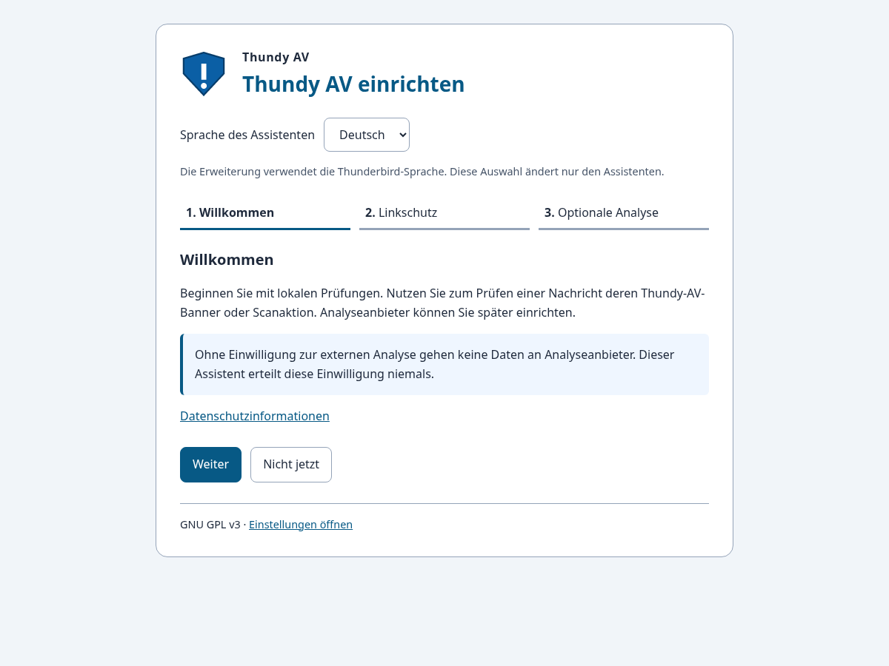
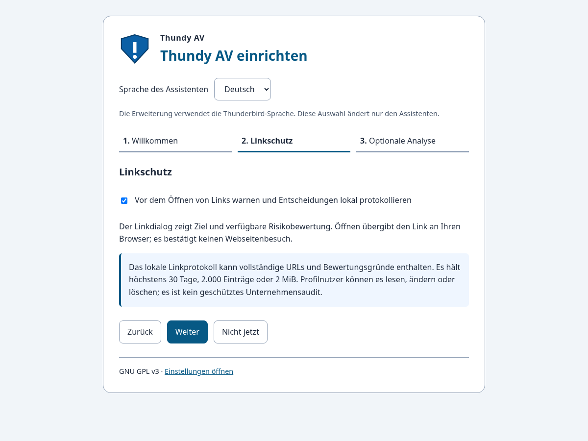
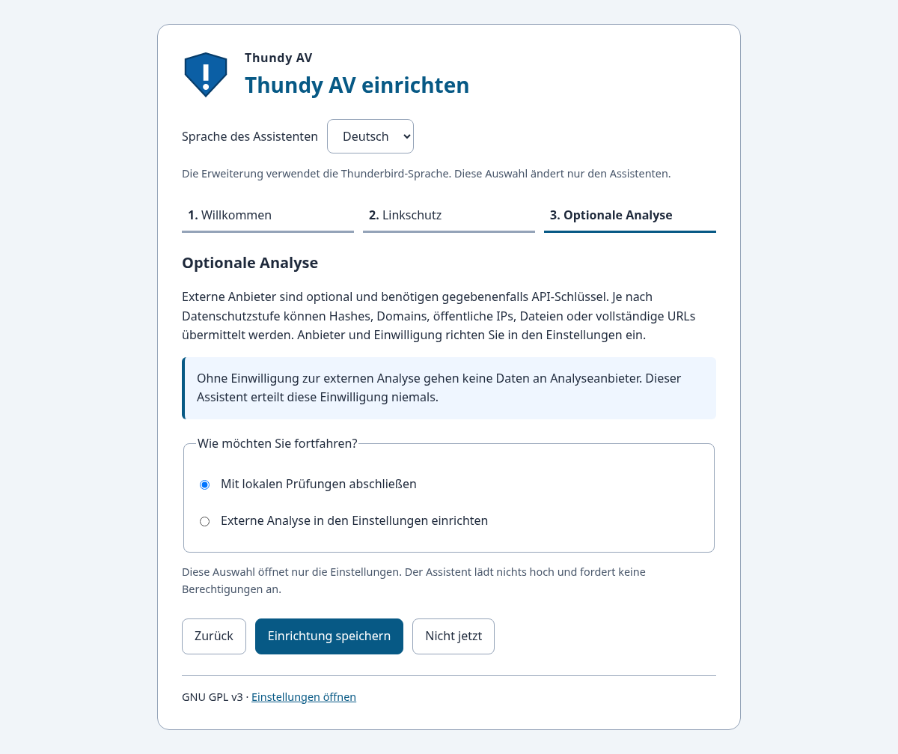

# Einrichtungsassistent nach der Installation

Ab Version **1.22.0** öffnet Thundy AV nach einer Erstinstallation einen eigenen Einrichtungstab. Updates öffnen ihn nicht erneut. Ein bereits als abgeschlossen gespeicherter Assistent wird auch bei einem weiteren Installationsereignis nicht automatisch geöffnet.

1. **Willkommen:** Lokale Prüfungen und Datenschutz. Eine Nachricht wird über ihren Thundy-AV-Banner oder eine Scanaktion geprüft.
2. **Linkschutz:** Vor Linköffnung warnen und Entscheidungen lokal protokollieren. Der Dialog zeigt Ziel und verfügbare Bewertung. „Geöffnet“ bestätigt die Übergabe an den Browser, keinen Webseitenbesuch. Das Protokoll kann vollständige URLs und Bewertungsgründe enthalten; Grenzen: 30 Tage, 2.000 Einträge oder 2 MiB. Es ist keine geschützte Unternehmensablage.
3. **Optionale externe Analyse:** Mit den bisherigen Einstellungen abschließen oder Anbieter in den Einstellungen konfigurieren. Erst dort können API-Schlüssel, Datenschutzstufe und Einwilligung gespeichert und Berechtigungen erteilt werden. Die Wahl im Assistenten erteilt keine Einwilligung.

Der Assistent ist vollständig in Englisch, Deutsch, Französisch, Spanisch, Italienisch und Polnisch verfügbar. Die Sprachauswahl gilt ausdrücklich nur für den Assistenten; die restliche Erweiterung folgt der Thunderbird-Sprache. Übersetzungen werden ausschließlich aus den mitgelieferten Katalogen geladen.

## Speichern und später fortsetzen

„Einrichtung speichern“ schreibt nur die geprüfte Auswahl zum Linkschutz und `onboardingState` mit Abschlusszeitpunkt. API-Schlüssel, externe Einwilligung, Absenderfreigaben, Datenschutzstufe und Protokolle werden nicht geändert. Bereits aktivierte externe Analyse wird ausdrücklich angezeigt und beibehalten; zum Deaktivieren die Einstellungen öffnen.

„Nicht jetzt“ schreibt nichts. Der Assistent bleibt über **Einstellungen → Einrichtungsassistent öffnen** erreichbar. Fehler beim Lesen verhindern das Speichern von Standardwerten über vorhandene Einstellungen. Speicherfehler lassen die Auswahl für einen erneuten Versuch stehen. Scheitert das Öffnen der Einstellungen nach erfolgreichem Speichern, kann es im Abschlussbildschirm erneut versucht werden.

Unternehmensprofile bleiben optionale, deaktivierte Konfigurationsentwürfe. Ihr Aufruf aktiviert keine Verbindung.

## Prüfung

Installations-/Updateereignisse, bestehende Abschlussmarker, Sprachabdeckung, Rechte-/Einwilligungsfreiheit, bestehende Einstellungen, Aufschub und Fehlerfälle werden automatisiert geprüft. Chromium prüft die Oberfläche mit gemockten Thunderbird-APIs. Die tatsächliche Erstinstallation in Thunderbird ist noch gemäß [Live-Abnahme](live_test_1_22_0.md) zu prüfen.

705 Tests und 96 Chromium-Zustände (sechs Sprachen × zwei Breiten × zwei Farbschemata × vier Schritte/Abschluss) bestanden. Die folgenden Bilder stammen aus Chromium mit gemockten Thunderbird-APIs, nicht aus einer echten Thunderbird-Installation.

