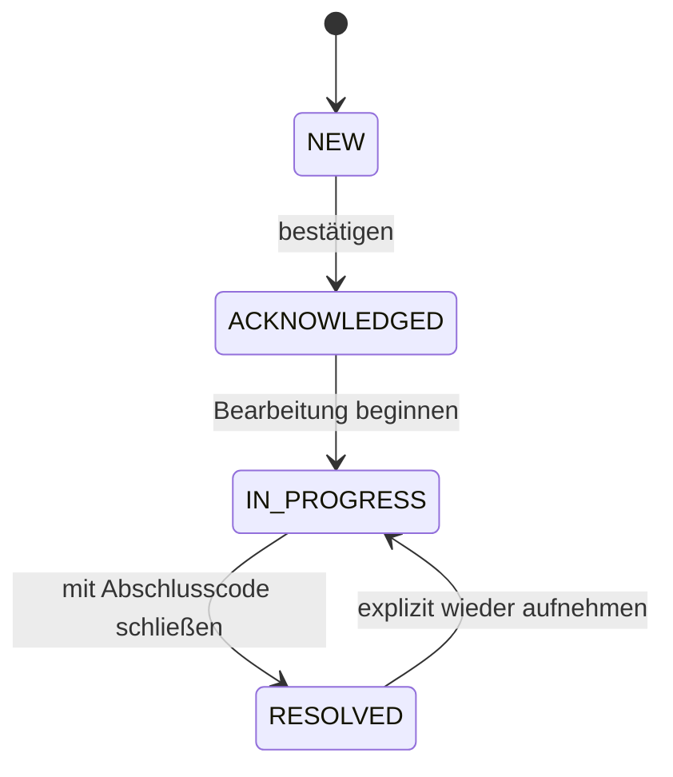

# Dauerhafte Incidentfälle und Public-Key-Prüfung

Stand: 14. Oktober 2026. N07 des [Ausführungsplans](ENTERPRISE_NAECHSTE_SCHRITTE.md) ergänzt die [Incidentregeln](ENTERPRISE_INCIDENTREGELN.md) um einen lokal nutzbaren Falllebenszyklus. Fälle, Zuweisung, Bearbeitungsrevisionen und Verlauf überstehen Neustarts. Der Baustein läuft ausschließlich außerhalb der Extension, ohne Netzwerk-/Ticketversand und ohne implementierte SSO-Rollen.

## Verhalten für Administratoren

Ein verifiziertes Entscheidungsereignis erzeugt pro treffender Regel einen reproduzierbaren Fall. Gespeichert bleiben die damalige Domain-URL, Score/Providerbefund/Modell, Policy- und Regelversionen sowie Event-/Quittungshashes. Eine spätere Neubewertung ersetzt den damaligen Score nicht. Wiederholtes Einlesen erzeugt keine weiteren Fälle und öffnet abgeschlossene Fälle nicht automatisch wieder. Neue Regelversionen erzeugen eigenständige Ableitungen.

Zustände:



Aktive Fälle lassen sich einer lokalen Bearbeiterkennung zuweisen oder entziehen. Abschlüsse verwenden ausschließlich `false_positive`, `remediated` oder `risk_accepted`; letzteres autorisiert keine Ausnahme oder Linköffnung. Freitextkommentare und beliebige URL-/Credentialtexte sind keine akzeptierten Änderungsfelder.

Jede Änderung benötigt die zuletzt gelesene Revision. Ist sie inzwischen veraltet, wird die Änderung abgewiesen. Der Verlauf nennt Journalindex, Zeitpunkt, lokale Akteurskennung, Aktion, Revision, Zustand, Zuweisung und Abschlusscode. Akteurskennungen sind Betreiberangaben, **keine bestätigten SSO-Identitäten**. Schutz und Autorisierung erfolgen in diesem Prototyp ausschließlich über den vertrauenswürdigen lokalen Operator und private Dateirechte.

## Öffentliche Konfiguration für Writer und Reader

```json
{
  "schemaVersion": 1,
  "organizationId": "11111111-1111-4111-8111-111111111111",
  "signerKeyId": "case-writer",
  "signerPublicKeyFile": "/srv/trust/case-public.pem",
  "serverKeyId": "server-1",
  "serverPublicKeyFile": "/srv/trust/server-public.pem",
  "registryFile": "/srv/trust/registry.json",
  "maxCases": 1000
}
```

Alle Felder erforderlich, keine Zusatzfelder. Pfade absolut; Registry genau `{"registrations": [...]}`. Ed25519-Public-PEMs, vertrauenswürdige Server-ID und Registrierungen derselben Organisation. Organisation, kanonisierte Trustwerte und Falllimit werden im Journal gebunden. Reader und Writer benötigen dieselben Werte. Schlüssel-/Registry-/Limitwechsel erfordern kontrollierte Migration statt stiller Wiederaufnahme.

## Fälle aufnehmen und bearbeiten

```sh
npm run enterprise:cases -- ingest \
  --directory /srv/local/cases --config /srv/trust/cases.json \
  --private-key /srv/keys/case-private.pem --actor-id ingest-worker \
  --export /srv/review/events.json --rules /srv/review/rules.json \
  --expected-head EXTERN_BEKANNTER_QUITTUNGSHASH
```

Der Writer prüft Originalexport und Regeln über die vollständige Ereignis-/Quittungsprüfung, bevor Fälle angenommen werden. Der optionale Kopf-Pin bindet hier das **Ereignisjournal**. Ein unsignierter Incidentreport ist keine zulässige Aufnahmequelle. Das CLI prüft den privaten Writer-Schlüssel gegen den gepinnten öffentlichen Fall-Schlüssel und fordert private, betreibereigene Schlüsseldateien (0600).

```sh
npm run enterprise:cases -- assign \
  --directory /srv/local/cases --config /srv/trust/cases.json \
  --private-key /srv/keys/case-private.pem --actor-id operator-1 \
  --case-id FALL_HASH --expected-revision 1 --assignee-id analyst-1
npm run enterprise:cases -- ack \
  --directory /srv/local/cases --config /srv/trust/cases.json \
  --private-key /srv/keys/case-private.pem --actor-id analyst-1 \
  --case-id FALL_HASH --expected-revision 2
```

Weitere Befehle: `start`, `resolve --resolution remediated|false_positive|risk_accepted`, `reopen`, jeweils mit Fall-ID und aktueller Revision. `assign --assignee-id -` hebt die Zuweisung auf. Kurzschlüsse von „neu“ direkt nach „abgeschlossen“, Zuweisung an abgeschlossene Fälle und beliebige Abschlusswerte werden abgewiesen. Wiederholung einer schon bestätigten Änderung mit alter Revision meldet Konflikt; anschließend den aktuellen Report lesen.

## Unabhängige Journalprüfung ohne Writer-Schlüssel

```sh
npm run enterprise:cases -- verify \
  --journal /srv/local/cases/actions.jsonl --config /srv/trust/cases.json \
  --expected-head EXTERN_BEKANNTER_FALLJOURNAL_HASH \
  --out /srv/review/cases.json
```

Dieser Pfad benötigt ausschließlich öffentliche Schlüssel. Er öffnet keinen Writer, verändert weder Journal noch Lock und funktioniert auch bei aktivem Writer. Der Kopf-Pin bindet hier das **Falljournal**. Ohne extern bekannten Pin sind gültige abgeschnittene Präfixe nicht als solche erkennbar; `headPinned: false` macht diese Grenze sichtbar.

Der Reader prüft Fallwriter-Signaturen, vollständige lokale Hashkette, Organisations-/Trustbindung, stabile Fallidentität, fachliche Zustandsübergänge und Revisionen. Der signierte Fallwriter bestätigt die ursprüngliche Ableitung. **Der Reader prüft nicht erneut die Original-Geräteevidenz**, die nicht vollständig im Falljournal gespeichert wird: `originalDeviceEvidenceReverified: false`. Dafür den ursprünglichen signierten Ereignisexport mit Event-/Quittungsreferenzen separat prüfen. Ein Falljournal ersetzt keine geschützte Evidenzablage.

Der Report enthält Fälle mit Verlauf und damaligen Entscheidungsdaten. Er ist eine unsignierte Zusammenfassung signaturgeprüfter Quelldaten; neue Datei mit 0600, kein Überschreiben. Domain-URLs und pseudonyme Geräte-/Bearbeiterkennungen können personenbezogen sein; nur an berechtigte Reviewer weitergeben. Es gibt noch keine rollenbasierte Portalansicht oder neue Benutzeroberfläche; der JSON-Vertrag nutzt sprachneutrale Codes. Das spätere Portal muss alle sechs mitgelieferten Sprachen unterstützen.

## API, Recovery und Grenzen

```js
const { IncidentCases } = require('./enterprise/incident_cases.cjs');
const store = new IncidentCases({
  directory, organizationId, trust, signerKeyId, signerPrivateKey,
});
store.ingest(eventExport, ruleSet, { actorId: 'ingest-worker', expectedHead });
const report = store.status();
store.close();
```

Änderungen: `assign(caseId, {actorId, expectedRevision, assigneeId})`, `transition(caseId, {actorId, expectedRevision, to, resolutionCode})`, `reopen(caseId, {actorId, expectedRevision})`. Public-Key-API: `IncidentCases.verifyJournal(content, {organizationId, trust, signerKeyId, signerPublicKey, maxCases, expectedHead})`.

Private POSIX-Verzeichnisse (0700), exklusiver Lock, signiertes Journal und Synchronisierung vor Bestätigung. Standardgrenzen: 1.000 Fälle, 32 MiB / 10.000 Aktionen. Keine Löschung oder Verdrängung bei Kapazitätsüberschreitung. Batchgrenzen werden vor Aufnahme geprüft; ein IO-/Prozessabbruch kann einen vollständigen Präfix hinterlassen. Wiederaufnahme prüft alle Aktionen; erneute Aufnahme ergänzt nur fehlende Fälle. Teilzeilen werden nicht automatisch repariert. Einen verwaisten Lock erst nach bestätigtem Ende des Writers manuell entfernen.

Ein Schreib-/Syncfehler bestätigt keine Änderung; weitere Schreib-/Statusaktionen des Writers sind bis zur geprüften Wiederaufnahme gesperrt. Eine vollständig geschriebene, aber nicht bestätigte Aktion kann nach Neustart vorhanden sein; daher vor erneutem Ändern den aktuellen Revisionsstand lesen. Ein Public-Key-Snapshot eines aktiven Writers beweist noch nicht dessen erfolgreiche fsync-Bestätigung.

Offen bleiben SSO-/Objekt-/Exportrechte, unabhängige Personen-/Rollenzuordnung, geschützter Schlüsselspeicher/Rotation, Enterprise-DB, zentrale UI, Ticketsysteme, Datenschutzfreigabe/Retention und produktive Abnahme. `sealed: false` bleibt unverändert. I01/I02 werden durch diesen lokalen Baustein nicht vollständig abgenommen.
