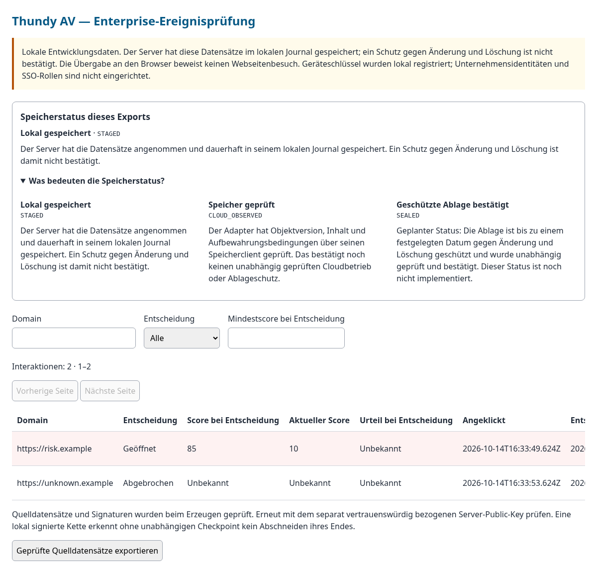

# Was bedeuten die Speicherstatus?

Die Speicherstatus beschreiben, was mit dem **Linkprotokoll** geschehen ist. Sie sagen nicht, ob ein Link sicher ist. URL, Score und Entscheidung „geöffnet“ oder „abgebrochen“ werden getrennt davon erfasst.

**Aktuell ist keine geschützte Ablage verbindlich bestätigt.** Die lokale Adminprüfung zeigt gespeicherte Entwicklungsdaten. Die Cloudadapter werden mit Testdoubles geprüft; ein produktiver Cloudbetrieb wurde nicht abgenommen.

| Verständliche Bezeichnung | Technische Kennung | Was damit bestätigt wird |
|---|---|---|
| Lokal gespeichert | `STAGED` | Der Entwicklungsserver hat die Datensätze angenommen und dauerhaft in seinem lokalen Journal gespeichert. Das schützt sie noch nicht gegen Änderung oder Löschung durch den Dateibesitzer. |
| Speicher geprüft | `CLOUD_OBSERVED` | Der Adapter hat Objektversion, Inhalt, Verschlüsselung und Schutzfrist über seinen Speicherclient geprüft. Das ist eine gespeicherte Beobachtung, noch keine unabhängige Bestätigung eines authentifizierten Cloudbetriebs. |
| Geschützte Ablage bestätigt | `SEALED` | Geplanter Status: Die Ablage ist bis zu einem festgelegten Datum gegen Änderung und Löschung geschützt. Schutzbedingungen und Inhalt wurden unabhängig geprüft und verbindlich bestätigt. Dieser Status ist noch nicht implementiert. |

„SEALED“ bedeutet wörtlich „versiegelt“. Gemeint ist die bestätigte geschützte Ablage des Protokolls. Eine gewöhnliche Prüfsumme, eine Signatur, ein erfolgreicher Upload oder die Wahl eines Cloudprofils erzeugen diesen Status nicht. Die Schutzfrist gilt für eine bestimmte Objektversion; auch Verschlüsselungsschlüssel, Wiederherstellung und Betreiberberechtigungen müssen abgesichert sein.

## Was sind optionale Speicherschnittstellen?

Die [Speicherschnittstellen für AWS S3, Azure und Google Cloud](ENTERPRISE_STORAGE_ADAPTER.md) erlauben die Vorbereitung auf einen vom Unternehmen gewählten Speicheranbieter. „Optional“ bedeutet: Ein Unternehmen kann einen passenden Anbieter wählen; die Extension aktiviert dadurch keine Verbindung und lädt keine Cloudclients.

Der lokale Simulator prüft das Schreiben und Zurücklesen einer Datei. Sein Abschluss heißt `SIMULATION_COMPLETE` und bietet keinen Schutz gegen Änderung oder Löschung. Der [Auftragsworkflow](ENTERPRISE_STORAGE_JOBS.md) speichert Bearbeitungszustände und wiederholt fehlgeschlagene Versuche. Ein abgeschlossener Auftrag allein ist keine SEALED-Bestätigung.

## Welche Aussage kann der Admin heute treffen?

Beispiel: Ein Link wurde mit Score 85 an den Browser übergeben und das Ereignis lokal gespeichert. Die Adminansicht zeigt **„Geöffnet“**, **„Score bei Entscheidung: 85“** und **„Lokal gespeichert · STAGED“**. Diese Angaben bestätigen weder einen tatsächlichen Webseitenbesuch noch eine gegen Änderung und Löschung geschützte Protokollablage.

Die Offline-Adminansicht erläutert die Speicherstatus in allen sechs unterstützten Sprachen. Die Quelldatensätze behalten ihre technischen Kennungen und Signaturen. Für eine erneute Prüfung braucht der Admin vertrauenswürdig bezogene Schlüssel und gegebenenfalls den separat bekannten [Witness-Checkpoint](ENTERPRISE_EVIDENZPRUEFUNG.md).

[Gesamter Umsetzungsstand](ENTERPRISE_UMSETZUNGSSTAND.md) · [Lokale Adminprüfung](ENTERPRISE_LOKALER_SERVICE.md)

Die separate [Übersicht der Speicheraufträge](ENTERPRISE_STORAGE_ADMIN.md) zeigt außerdem Bearbeitung, Fehler, Wiederholungen und Schutzfristen; sie löst keine Schreibaktionen aus.

## Beispielansicht

Synthetische Entwicklungsdaten, keine echten Mitarbeiterereignisse. Die Statuserklärung ist aufgeklappt; die Ereignistabelle bleibt horizontal scrollbar.

