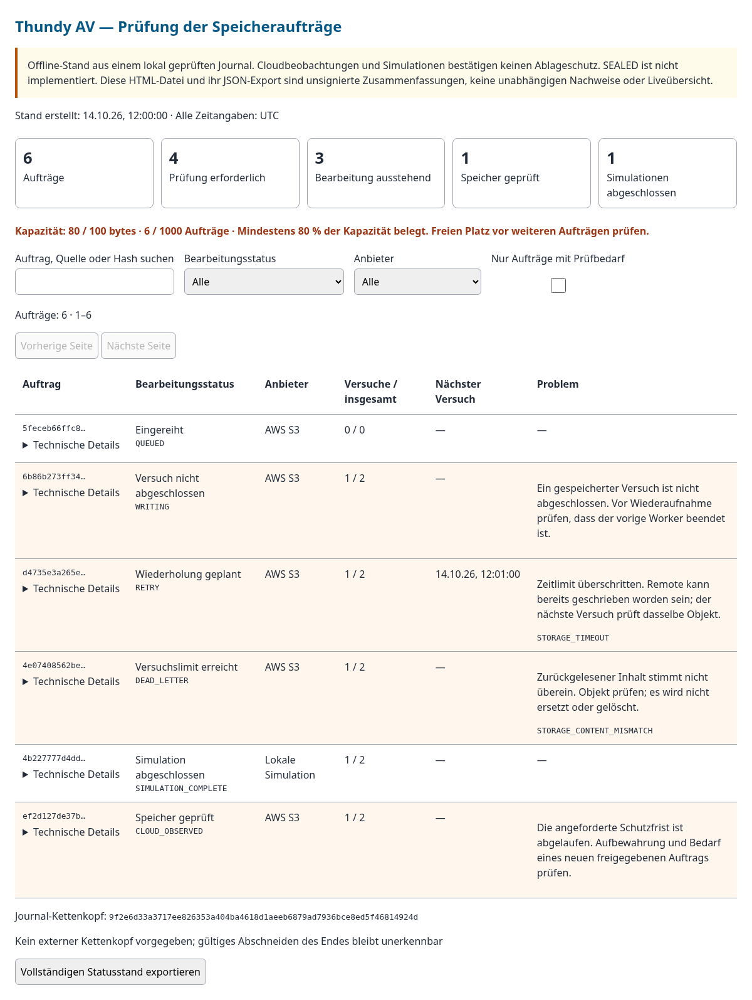

# Speicheraufträge als Admin prüfen

Stand: 14. Oktober 2026. Die dauerhaft gespeicherten [Speicheraufträge](ENTERPRISE_STORAGE_JOBS.md) besitzen jetzt eine eigene sechssprachige Offline-Übersicht. Sie hilft bei der Prüfung von Bearbeitungszuständen, Fehlern, Wiederholungen und beobachteten Objektversionen.

**Der Bericht ist eine Momentaufnahme, keine Live-Konsole.** Er enthält keine Schreibaktionen. Er löst weder Cloudzugriffe noch Wiederholungen oder Löschungen aus. Die Quellenprüfung erfolgt beim Erzeugen durch den bisherigen Job-CLI-Prozess. HTML und JSON-Ausgabe sind unsignierte Zusammenfassungen; sie ersetzen keine unabhängig prüfbaren signierten Quelldatensätze. SEALED bleibt nicht implementiert.

## Bericht erzeugen

Jobkonfiguration und Queue gemäß [Storage-Schnellstart](ENTERPRISE_STORAGE_JOBS.md) vorbereiten. Der Worker muss seinen exklusiven Journal-Lock freigegeben haben. Eine neue Ausgabedatei wählen:

```sh
npm run enterprise:storage-jobs -- review --queue /tmp/thundy-storage-queue --config /tmp/thundy-storage-keys/config.json --lang de --out /tmp/thundy-storage-review.html
```

Unterstützt: `en`, `de`, `fr`, `es`, `it`, `pl`; Standard Englisch. Die Datei wird mit privaten POSIX-Rechten 0600 erzeugt. Eine vorhandene Ausgabe wird nicht überschrieben. Der Bericht öffnet keine externe Adresse, lädt keine Webfonts oder Skripte nach und benötigt keine Netzwerkverbindung. Er bleibt außerhalb des Thunderbird-XPI.

Mit einem unabhängig bekannten Journal-Kettenkopf:

```sh
npm run enterprise:storage-jobs -- review --queue /tmp/thundy-storage-queue --config /tmp/thundy-storage-keys/config.json --lang de --expected-head BEKANNTER_JOB_HEAD --out /tmp/thundy-storage-review-pinned.html
```

Der CLI-Prozess vergleicht diesen Kopf vor der Berichtserzeugung. Der Bericht weist ausdrücklich aus, ob ein Kopf vorgegeben wurde. Ohne extern bekannten Kopf kann auch ein lokal gültig signierter, aber am Ende verkürzter Journalstand unbemerkt bleiben. Den erwarteten Kopf nicht aus einer möglicherweise manipulierten Datei ableiten. Ein Job-Kopf ist kein Witness-Pin und kein SEALED-Nachweis.

## Was die Übersicht zeigt

- Gesamtzahl, Aufträge mit Prüfbedarf, ausstehende Bearbeitung, geprüfte Speicher und abgeschlossene Simulationen. Die Übersichtszahlen beziehen sich auf den vollständigen Snapshot.
- Byte- und Auftragskapazität; ab 80 % Auslastung erscheint eine ausdrückliche Warnung zusätzlich zur farblichen Kennzeichnung.
- Filter nach Bearbeitungsstatus, Anbieter und Prüfbedarf sowie Suche nach Job-ID, Quell-ID oder Inhaltshash. Die Tabelle zeigt jeweils höchstens 50 Aufträge; Filter setzen die Seitenauswahl zurück.
- Aktuelle Versuche im Retryzyklus und Gesamtversuche, letzten Änderungszeitpunkt, geplante Wiederholung und gespeicherte Fehlercodes mit Erläuterung.
- Aufklappbare Details mit Quell-ID, SHA-256, Anzahl der Ereignisse im Evidenzsnapshot, Objektversion und angeforderter bzw. beobachteter Schutzfrist. Quell-ID und Hash ermöglichen die Zuordnung zum Evidenzobjekt; Ereignis-URLs und Scores werden in dieser Betriebsübersicht nicht erneut exportiert.

Zeitangaben werden sprachgerecht dargestellt und ausdrücklich in **UTC** angegeben. Der ursprüngliche ISO-Zeitpunkt steht zusätzlich im `datetime`-Attribut und als Tooltip. Die Fristprüfung verwendet den Zeitpunkt der Berichtserzeugung, nicht die später eingestellte Browseruhr. Ein alter Bericht aktualisiert sich nicht selbst.

## Prüfbedarf richtig verstehen

| Anzeige | Bedeutung / Betreiberprüfung |
|---|---|
| Versuch nicht abgeschlossen | Ein `ATTEMPT` ist gespeichert, aber kein Abschluss. Vor Wiederaufnahme prüfen, ob der bisherige Worker wirklich beendet ist. |
| Wiederholung geplant | Ein Fehler und der nächste früheste Versuch sind dauerhaft gespeichert. Die Übersicht führt diesen Versuch nicht aus. |
| Versuchslimit erreicht | Dead Letter bleibt mit Evidenz und Historie erhalten. Ursache prüfen; Betreiber-Retry erfolgt separat über die vorhandene CLI. |
| Zeitlimit überschritten | Ein Remoteobjekt kann trotz Timeout bereits existieren. Der nächste freigegebene Versuch prüft dasselbe bedingt geschriebene Objekt. |
| Zurückgelesener Inhalt stimmt nicht überein | Objekt prüfen. Der Bericht ersetzt oder löscht nichts. |
| Angeforderte Schutzfrist abgelaufen | Aufbewahrung und gegebenenfalls einen neuen genehmigten Auftrag prüfen. Der gespeicherte Bearbeitungsstatus wird dadurch nicht umgeschrieben. |
| Speicher geprüft | Die damalige SDK-Beobachtung ist vorhanden. Sie ist kein unabhängiger Nachweis des Cloudbetriebs und keine bestätigte geschützte Ablage. |

„Prüfbedarf“ umfasst wiederholte, unvollständige und ausgeschöpfte Versuche sowie abgelaufene angeforderte Fristen. Ein Auftrag kann gleichzeitig „Speicher geprüft“ und „Frist abgelaufen“ zeigen. Die Karten zählen deshalb keine sich gegenseitig ausschließenden Kategorien.

## Export und Zugriff

„Vollständigen Statusstand exportieren“ erzeugt JSON vom Typ `thundy-storage-jobs-review`. Der Export umfasst alle Aufträge dieses Snapshots, unabhängig von den sichtbaren Filtern. Er enthält nur Statusfelder, IDs, Hashes, Versions-/Fristangaben und Zähler. Ereignis-Payloads, URLs, Zielsettings, Pfade, Credentials und Signierschlüssel werden nicht übernommen. Auch zusätzliche unbekannte Eingabefelder werden nicht in den Report kopiert.

Die generierte Datei kann durch ihren Besitzer geändert werden. Ihre eingebetteten Angaben zur vorherigen Prüfung oder zum Kopfvergleich sind keine eigene Signatur. Für erneute Quellenprüfung das signierte Jobjournal mit der vertrauenswürdigen Konfiguration öffnen und gegen einen separat bekannten Kopf prüfen. Der ursprüngliche Writer-CLI benötigt den lokalen Signierschlüssel. Der neue [Public-Key-Prüfpfad](ENTERPRISE_PUBLIC_KEY_PRUEFUNG.md) erzeugt denselben Report ohne privaten Schlüssel und ohne Writer-Lock. Unternehmens-RBAC und die unabhängige produktive Trustverteilung bleiben offen. Browser-Downloads erhalten die Rechte der Browserumgebung, nicht automatisch 0600; auch diese Dateien nach den Unternehmensvorgaben behandeln.

Dies ist eine lokale Betriebsansicht mit OS-basierter Zugriffskontrolle. Zentrale SSO-/Rollenprüfung, laufende Überwachung, Benachrichtigungen und eine produktive Anbindung an die Ereignis-Adminansicht fehlen weiterhin. Die [Ereignisprüfung](ENTERPRISE_LOKALER_SERVICE.md) zeigt separat URL/Domain, Score und Öffnungsentscheidung. [Speicherstatus ohne Fachkürzel erklärt](ENTERPRISE_SPEICHERSTATUS.md).

## Prüfung und Beispiel

11 neue Tests prüfen die sechs Sprachansichten, Filter, Pagination, vollständigen JSON-Export trotz Filtern, sichere Darstellung fremder Versionsstrings, Reduktion auf Statusfelder und Abweisung falscher SEALED-Angaben. Die vorhandene CLI-Suite prüft zusätzlich die tatsächliche Berichtserzeugung, private Dateirechte, unveränderten Journalkopf und Schutz gegen Überschreiben. 24 Chromium-Layouts mit sechs Sprachen, zwei Breiten und hellen/dunklen Farben sowie ein tatsächlicher Browserdownload wurden geprüft. Das Gesamtgate umfasst 690 erfolgreiche Tests.

Synthetische Beispielzustände, keine echten Unternehmensereignisse oder Cloudbelege:


