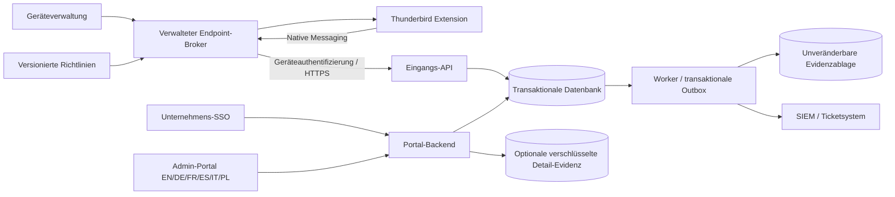

# Thundy AV: vollständiges Enterprise-Umsetzungskonzept

Stand: 14. Oktober 2026 · Grundlage: Extension 1.20.0, Commit `c70be55`.

**Status: ausgearbeitetes Zielbild und Implementierungsplan. Die nachfolgenden Enterprise-Funktionen sind noch nicht implementiert oder produktiv freigegeben.** Das bestehende lokale Linkprotokoll bleibt verfügbar. Dieses Konzept behandelt genau die sechs gewünschten Punkte:

1. Zentrale Ereignissammlung und SIEM-Anbindung.
2. Gesperrte Admin-Richtlinien einschließlich begründeter Ausnahmefreigaben.
3. Geschützte, serverseitig überprüfbare Nachweise.
4. SSO und Rollenrechte.
5. Warnungen, Incident-Tickets und Sicherheitsübersicht.
6. Versions-/Zustandsüberwachung, Aufbewahrung und URL-Maskierung.

## 1. Ziel, Umfang und belastbare Grenzen

Administratoren sollen nachvollziehen können, welche **vom Linkschutz abgefangenen** Links mit welchem damaligen Kenntnisstand geöffnet, abgebrochen oder gesperrt wurden. Die Lösung muss Ausfälle sichtbar machen, Unternehmensrichtlinien durchsetzen und berechtigte Prüfer bei der Untersuchung unterstützen.

Vorhanden: lokale URL-/Score-/Entscheidungsaufzeichnung, Entscheidungs-Snapshots, Filter, JSON/CSV, sechs Sprachen und begrenzte lokale Aufbewahrung. Lücken: keine zentrale Zustellung, keine Unternehmensgeräteidentität, keine gesperrten Richtlinien, keine Rollenprüfung, keine serverseitige Signatur oder unveränderbare Ablage, kein Incident-Workflow und keine Flottenüberwachung. Der SHA-256-Export aus 1.20.0 authentifiziert keine Herkunft.

**Nachweisgrenzen bleiben auch im Zielbild sichtbar:** `OPENED` bestätigt einen gemeldeten erfolgreichen Browser-Handoff, keinen Webseitenbesuch. Signierte Geräteereignisse können gefälschte Berichte eines kompromittierten Clients nicht ausschließen. Nicht beobachtete Klicks, native Kontextmenü-Öffnungen, andere Browser und deaktivierte/deinstallierte Clients erzeugen keine vollständige Nutzungsbilanz. Heartbeats zeigen Erreichbarkeit, nicht lückenlose Aktivität. Ein vollständiger Navigationsschutz benötigt zusätzliche Browser-/Endpoint-Kontrollen außerhalb dieser Extension.

Unverwaltete Installationen behalten lokale Funktionen und EN/DE/FR/ES/IT/PL. Die Enterprise-Anbindung wird ausdrücklich eingerichtet; bestehende Zustimmung zu externen Analyseanbietern darf nicht als Zustimmung zu zentraler Unternehmensprotokollierung umgedeutet werden. Anbieterübermittlung, zentrale Auditübermittlung und Mitarbeiterzuordnung sind getrennte Zwecke und technische Berechtigungen.

## 2. Empfohlene Architektur und Vertrauensgrenzen

Empfehlung: eine vom Unternehmen betriebene zentrale Lösung, zunächst für **eine Organisation**, mit strikter Organisationszuordnung in jedem Datenzugriff. Kein öffentliches, anonymes Sammel-API und kein Drittanbieter-Analytics-Frontend.

| Baustein | Verantwortung | Grenze |
|---|---|---|
| Extension | Klickdialog, Bewertung, Entscheidungs-Snapshot, sichtbarer Verwaltungsstatus | Keine langlebigen Unternehmensgeheimnisse in `storage.local`; keine eigenen Adminrechte |
| Endpoint-Broker | Geschützte Geräteidentität, persistente Warteschlange, signierte Richtlinien, Heartbeats | Als signiertes OS-Paket durch Geräteverwaltung installiert; Native-Messaging-Zugriff nur für die Extension-ID |
| Eingangs-API | Geräteauthentifizierung, Schema-/Sequenzprüfung, Deduplizierung, Eingangszeit | Organisations-/Gerätezuordnung aus geprüfter Identität, niemals ausschließlich aus Request-Feldern |
| Datenbank | Projektionen, Geräte, Richtlinien, Incidents, Zustellstatus | Abfragen parametrisiert, Organisationsgrenzen serverseitig; kein unbegrenzter Vollscan |
| Evidenzablage | Unveränderbare Objekte, signierte Empfangsnachweise und Checkpoints | Eigene Schreibidentität; Prüfer dürfen nicht löschen oder umschreiben |
| Portal-Backend | OIDC-Anmeldung, Rollen-/Objektprüfung, Exporte, Zugriffsaudit | Serverseitige Session; keine pauschalen Adminrechte aus beliebigen Token-Claims |
| Connector-Worker | SIEM-/Ticketzustellung, Fehlerbehandlung, Deduplizierung | Separater Dienstaccount und Secretspeicher; keine Detail-URL als Standardpayload |

Planungsbasis: gewartete Node.js-LTS-Version, PostgreSQL, HTTPS-Reverse-Proxy, S3-kompatible Ablage mit tatsächlich getesteter Retention-/Object-Lock-Funktion, zentraler Secretspeicher und etablierte OIDC-Bibliothek. Keine selbst geschriebene Kryptografie oder Tokenprüfung. Ein Anbieter ist erst nach Infrastrukturentscheidung verbindlich.

Der Broker ist die bevorzugte Unternehmensvariante: Geräte-Schlüssel und Outbox bleiben außerhalb des frei änderbaren Thunderbird-Profils. Eine rein extensionbasierte Pilotvariante ist möglich, hat aber geringeren Schutz gegen Profiländerungen und darf nicht mit derselben Nachweisqualität beworben werden. OS-Administratoren und kompromittierte Endpoints bleiben eine Vertrauensgrenze.

**Thunderbird-Besonderheit:** `storage.managed` ist laut aktueller Thunderbird-Dokumentation schreibgeschützt, unterstützt jedoch weder plattformspezifische Registry-Backends noch Erweiterungsschema-Durchsetzung oder `onChanged` für Managed Storage. Deshalb: eigenes Schema prüfen, Richtlinien beim Start und periodisch einlesen; Windows-Registry-Verteilung oder sofortige Change-Events nicht voraussetzen. Native Messaging, Geräteverteilung und tatsächlich verfügbare Managed-Konfiguration werden zuerst auf Thunderbird 140 ESR und der dann aktuellen Version mit Windows, macOS und Linux nachgewiesen. [Offizielle storage-Dokumentation](https://webextension-api.thunderbird.net/en/mv3/storage.html#managed).

## 3. Punkt 1 — zentrale Ereignissammlung und SIEM

### Ereignismodell

Der zentrale Kanal verwendet **unveränderbare Einzelereignisse**, keine nachträglich überschriebenen lokalen Datensätze. Eine Interaktion besitzt eine eigene `interactionId`; jede Zustandsmeldung erhält eine eindeutige `eventId` und eine monoton steigende `sequence` innerhalb einer serverseitig registrierten Geräte-Stream-Epoche.

| Ereignis | Aussage | Projektion |
|---|---|---|
| `CLICKED` | HTTP(S)-Klick abgefangen | Entscheidung offen |
| `ASSESSMENT` | Aktuell verfügbare lokale Bewertung / Anbieterurteil | Kein Öffnen oder Abbrechen ableiten |
| `OPEN_INTENT` | Bestätigter Öffnungswunsch mit Entscheidungs-Snapshot | Übergabe noch unbestätigt |
| `DECISION` + `OPENED` | Erfolgreicher Browser-Handoff gemeldet | Geöffnet |
| `DECISION` + `ABORTED` | Expliziter Abbruch mit Grund | Abgebrochen |
| `DECISION` + `BLOCKED` | Richtlinie hat die Öffnung gesperrt | Gesperrt |
| `DECISION` + `OPEN_ERROR` | Übergabe scheiterte | Wiederholung bleibt dieselbe Interaktion |
| `ASSESSMENT_UPDATED` | Spätere Prüfung abgeschlossen | Frühere Entscheidung nicht rückwirkend verändern |

Wiederholte Öffnungsversuche haben eine fortlaufende `attemptNumber`. Nach `OPEN_ERROR` darf ein weiterer Versuch folgen; nach erfolgreicher Öffnung oder Abbruch nicht. Ein neues tatsächliches Linkklicken beginnt eine neue Interaktion. Clientzeit und Server-Empfangszeit bleiben getrennt; bei Uhrabweichung wird eine Qualitätswarnung gespeichert. Lokaler Score ist 0–100 oder `null`; Anbieterurteil bleibt eigenständig. Keine künstliche Umrechnung `UNKNOWN = 0` oder `CLEAN = garantiert sicher`.

### Zustellung und Bestätigung

1. Broker schreibt Ereignis und Sequenz atomar in seine persistente Outbox, bevor der Client einen dauerhaften lokalen Erfolg meldet.
2. Batches: höchstens 100 Ereignisse und 256 KiB. Größere gültige Ereignisse separat bis maximal 32 KiB pro Ereignis; darüber expliziter Fehler, keine stille Abschneidung relevanter Evidenz.
3. Transport mit Geräteauthentifizierung; Retry mit exponentiellem Backoff, Zufallsanteil, Obergrenze fünf Minuten und Beachtung von `Retry-After`. Richtwert: zehn Sekunden Request-Deadline.
4. Server bestätigt jedes Ereignis separat. Gleiche `eventId` mit gleichem Inhalt: vorhandenen Nachweis zurückgeben. Gleiche ID mit anderem Inhalt: `409`, Sicherheitsfall und Quarantäne.
5. Datenbank-Commit bestätigt zunächst nur `STAGED`. Erst eine geprüfte, signierte `SEALED`-Quittung nach dauerhaftem Evidenz-Commit erlaubt, die Payload aus der Outbox zu entfernen. Der Client kann Quittungen erneut abrufen.
6. Verlorene Antwort, Prozessneustart und doppelte Workerzustellung sind normale Zustände. Keine „exactly once“-Transportbehauptung: mindestens einmal zustellen, idempotent verarbeiten.
7. Ungültige Ereignisse einzeln markieren; der übrige Batch wird verarbeitet. Endgültig abgewiesene Einträge gehen mit Grund in eine sichtbare Dead-Letter-Ablage, nicht in eine Endlosschleife.

**Outbox ≠ lokaler Review-Cache:** die derzeitigen 2 MiB/2.000 Einträge aus `link_audit.js` dürfen unbestätigte Ereignisse nicht entfernen. Vorschlag für den Broker: 100 MiB oder 10.000 Ereignisse, maximal sieben Tage Offline-Puffer, jeweils konfigurierbar. Bei 80 % Warnung; bei Vollstand/Ablauf keine stillen Verluste. Der weiter unten definierte Öffnungs-Ausfallmodus entscheidet, ob neue Öffnungen gesperrt werden. Mengenverluste werden als Gap-/Capacity-Ereignis gemeldet; der fehlende Inhalt wird nicht erfunden.

### SIEM

MVP: strukturiertes JSON über authentifiziertes HTTPS an einen explizit freigegebenen Unternehmens-Endpunkt. Danach CEF oder Syslog über TLS nach Bedarf. Kein unverschlüsseltes UDP für personenbezogene Evidenz. Standardpayload enthält Ereignis-/Interaktions-ID, Gerät, maskierte Domain, Entscheidungs-Snapshot, Richtlinienversion, Empfangszeit und Incident-ID. API-Schlüssel, Nachrichtentext und vollständige URL sind ausgeschlossen.

Connectorzustellung nutzt eine serverseitige transaktionale Outbox. Das Dashboard trennt „zentral aufgenommen“ von „an SIEM zugestellt“. Teilfehler, Ausfall, Rate-Limits und Credential-Rotation sind sichtbar. Freie Ziel-URLs werden nicht aus Nutzereingaben oder Events übernommen; Ziel-/DNS-/Redirect-Prüfung verhindert SSRF und das Abfließen an unbeabsichtigte Systeme.

**Abnahme E1:** 24-Stunden-Offline-Lauf und Neustarts verlieren keine unter den Puffergrenzen aufgenommenen Ereignisse; 10.000 Wiederholungen erzeugen keine doppelten Interaktionen/Incidents. Verlorene Antworten führen zur gleichen Quittung. Konflikte, volle Queue und Dead Letters werden sichtbar. Nach wiederhergestellter Verbindung laufen Backlogs kontrolliert ab. Kein zentraler Upload in unverwalteten Profilen.

## 4. Punkt 2 — gesperrte Richtlinien und Ausnahmefreigaben

### Richtlinienmodell

Ein geprüftes, signiertes Policy-Dokument enthält ID, monotone Version, Gültigkeitszeit, Organisations-/Gruppenscope, minimale Clientfähigkeit, Schutzregeln, Datenumfang und Fehlerverhalten. Signatur und Schema werden **vor** Aktivierung geprüft; Änderungen werden atomar angewandt. Die vollständige zuletzt gültige Policy bleibt als Offline-Fallback erhalten. Der Capability-Vertrag (`event-v2`, `policy-v1`, `broker-v1`, `sealed-receipts`) verhindert, dass eine bisherige 1.20.0-Installation nur wegen einer passenden Versionszahl als Enterprise-fähig gilt. Die Signatur allein reicht nicht: Scope, Ablauf, Mindestversion und Rollbackschutz müssen ebenfalls passen.

Präzedenz: unveränderliche Produktgrenzen und tatsächlich erteilte Thunderbird-Berechtigungen → verbindliche Unternehmensregeln → freigegebene Gruppenausnahmen → lokale Nutzerwerte für ausdrücklich nicht verwaltete Felder. Datenschutzregeln dürfen nicht durch ein engeres Gruppenprofil heimlich erweitert werden. Die Policy kann externe Analyse untersagen; erlaubende Policies erteilen weder Thunderbird-Hostrechte noch die bestehende Zustimmung automatisch.

Verwaltete Felder: Linkschutz, Scan-Stufe und Anbieterfreigaben, Übermittlung vollständiger URLs, Block-/Warnschwellen, Behandlung unbekannter Urteile, Auditpflicht, definierte Domains, Datenauswahl, Queue-/Retention-Grenzen und freigegebene Ausnahmen. Provider-Secrets werden bevorzugt in einem Unternehmens-Analyse-Gateway gehalten. UI zeigt Wert, Quelle, Policy-Version und Sperrgrund; deaktivierte Eingabefelder ersetzen keine Durchsetzung im Hintergrund.

### Vorgeschlagene Öffnungsregeln

Diese Werte sind Startwerte für einen Pilot, keine bereits kalibrierten Risikomodelle:

| Zustand | Reaktion |
|---|---|
| Explizite Unternehmens-Sperrliste oder Anbieter `MALICIOUS` / `MALICIOUS_VISUAL` | Sperren; Standardnutzer können nicht übersteuern |
| Lokaler Score ≥ 80 oder Anbieter `SUSPICIOUS` | Sperren oder Ausnahme beantragen, abhängig von Policy |
| Lokaler Score 50–79 | Warnung; bei erlaubtem Override Begründung erfassen |
| Fehlender Score oder `UNKNOWN`/`ERROR`/`TIMEOUT` | Eigenständige Unknown-Regel; nicht als niedriger Score behandeln |
| Keine Warnindikatoren | Öffnen nach vorhandener Bestätigung; keine Sicherheitsgarantie |
| Allowlist-Eintrag | Nur ausdrücklich zulässige Heuristikausnahmen; kein genereller Override von Anbieter-Malwareurteilen |

Gleiches Policy-Modul entscheidet im Dialog und vor **jedem** Hintergrund-Öffnungsaufruf. Die heutige Legacy-Route `openCheckedLink` ohne Interaktions-ID darf in verwalteten Profilen keinen Audit-/Policy-Bypass erlauben. URL, Nachrichtenkontext, Interaktions-ID und effektive Policy werden unmittelbar vor Öffnung erneut geprüft.

### Ausfallmodus

| Situation | Vorgeschlagener verbindlicher Standard im verwalteten Pilot |
|---|---|
| Keine gültige Policy beim Erststart / falsche Signatur / unerfüllte Client-Mindestversion | Verwaltete Linköffnung sperren; Supporthinweis, kein stiller Wechsel in Privatmodus |
| Policy-Endpunkt offline, gültige Cache-Policy vorhanden | Cache-Policy bis zu ihrem Ablauf anwenden |
| Cache-Policy abgelaufen | Keine neuen verwalteten Linköffnungen; bereits protokollierte Vorgänge bleiben sichtbar |
| Auditpflicht `requireSealedIntent`, Empfang nicht bestätigt | Öffnung verweigern; `OPEN_INTENT` bleibt offen, nicht als geöffnet zählen |
| Offline-Modus `queueAllowed`, Queue gesund und gültige Policy | Öffnung nach lokaler dauerhafter Intent-Aufnahme erlaubt; als offline aufgezeichnet kennzeichnen |
| Broker fehlt / Queue nicht dauerhaft beschreibbar | Sperren bei Auditpflicht; expliziter technischer Zustand statt falschem Öffnungserfolg |
| Analyseanbieter offline | Unknown-Regel der Policy; kein automatischer sauberer Befund |

`OPEN_INTENT` wird vor Übergabe bestätigt; `OPENED` darf erst **nach** erfolgreichem Handoff entstehen. Eine vorab erzwungene Serverbestätigung eines angeblich bereits geöffneten Links wäre ein falscher Nachweis. Offline-Erlaubnis versus strikter Auditpflicht ist eine bewusste, versionierte Unternehmensentscheidung.

### Ausnahmen

Antrag umfasst genaue normalisierte URL/Domain, Interaktions-ID, Risikostand, Zweck, beantragte Dauer und Antragsteller. Freigabe erfolgt durch eine gesonderte berechtigte Rolle, niemals durch Selbstfreigabe. Signiertes Ausnahme-Ticket: Scope, Policy-Version, Ablauf, erlaubte Aktion, maximale Verwendung (Standard: einmal), Freigeber und Grund. Serverseitige Verbrauchsbuchung verhindert parallele Wiederverwendung. Standardgültigkeit 15 Minuten; keine pauschale, dauerhafte Freigabe aller URLs einer Person.

Policy-Lebenszyklus: Entwurf → technische Validierung/Simulation → Vier-Augen-Freigabe → Pilotgruppe → aktive Version → Ablösung. Rollback veröffentlicht eine **neue höhere** Version mit früherem Inhalt; er deaktiviert keine bereits geltenden Evidenzregeln. Veröffentlichtes Dokument bleibt überprüfbar. Notfallausnahmen haben enges Zeitfenster, sichtbaren Grund und nachträgliche Prüfung.

**Abnahme E2:** lokale Speicheränderungen, direkte Runtime-Nachrichten, Legacy-Öffnung und manipulierte UI umgehen keine verwaltete Regel. Ungültige/abgelaufene/fremde Policies und wiederverwendete Ausnahme-Tickets scheitern. Keine Rechte oder externe Zustimmung werden automatisch erweitert. Rollen- und Offline-Matrix ist auf drei OS und den Ziel-Thunderbird-Versionen getestet.

## 5. Punkt 3 — geschützte Nachweise

Jeder bestätigte Datensatz besitzt drei unterscheidbare Belege:

1. **Herkunft:** Geräteauthentifizierung plus Signatur des Brokers über kanonisiertes Ereignis (JCS/RFC 8785), gebunden an registrierten Schlüssel, Stream-Epoche, Sequenz, Ereignis-ID und Policy-Version. Hardware-/OS-Schlüsselspeicher bevorzugen; Exportfähigkeit und Rechte im OS-Pilot messen.
2. **Serverempfang:** signierte Quittung mit Serverzeit, geprüfter Geräteidentität, Payload-Hash, Eingangs-ID, Status und Server-Schlüssel-ID. `SEALED` erst nach tatsächlicher unveränderbarer Aufnahme.
3. **Aufbewahrung:** unveränderbare Ereignisobjekte und verkettete Checkpoints; täglicher signierter Abschluss wird in einer getrennten, stärker geschützten Ablage verankert. Eine Hash-Kette in derselben frei änderbaren Datenbank verhindert kein vollständiges Neuschreiben oder Abschneiden.

Datenbankprojektionen können neu aufgebaut werden; sie sind nicht die einzige Evidenzquelle. Änderungen an Incidents, Rollen, Richtlinien und Zugriffen sind zusätzliche append-only Adminereignisse. Spätere Prüfergebnisse ergänzen neue Ereignisse, nicht historische Snapshots. Server-Sequenzlücken, doppelte Sequenzen und neu registrierte Streams sind sichtbar; eine Lücke verrät nicht automatisch, welche Aktion fehlte.

Schlüsselrotation erhält frühere öffentliche Schlüssel und ihre Gültigkeits-/Sperrzeiträume. Neue Schlüssel benötigen bestätigte Registrierung; nach Widerruf keine neuen gültigen Einlieferungen. Historische Nachweise werden anhand ihrer Empfangszeit und des dokumentierten Schlüsselstatus beurteilt, nicht schlicht mit dem heutigen Schlüssel. Server-Signaturschlüssel liegen außerhalb der Anwendungsdatenbank; Recovery und Rotation sind eigene Runbooks.

Ein Prüfexport enthält redigierte Ereignisse, Geräte-/Servernachweise, notwendige öffentliche Schlüssel, Policy-Referenzen, Checkpoints, Gaps und Verifikationsbericht. Verifikationswerkzeug arbeitet offline und erkennt geänderte Payloads, falsche Signaturen, fehlende Sequenzen und nicht verankerte Abschlüsse. Es behauptet ausdrücklich weder vollständige Endpunktaktivität noch tatsächliche Webseitenbesuche.

**Retention und Unveränderbarkeit müssen zusammenpassen:** Object-Lock-Dauer ist pro Datenklasse festgelegt; sie darf nicht länger als der dafür freigegebene Aufbewahrungszweck sein. Daten werden vor Aufnahme minimiert. Nach Ablauf: nachvollziehbare Löschung einschließlich Projektionen, Connectorcopies im eigenen Verantwortungsbereich und Detail-Evidenz. Ein Legal Hold ist begründet, zeitlich überprüft und von getrennten Rollen freigegeben. Eine bereits gesperrte Retention kann technisch nicht beliebig nachträglich verkürzt werden; dieses Risiko muss vor dem Pilot entschieden sein.

**Abnahme E3:** Veränderung und Abschneiden werden im Offline-Prüfer erkannt; normale Admin-/Servicekonten können Evidenz nicht umschreiben. Crash zwischen Datenbank und Objektablage ergibt nur `STAGED`, niemals falsches `SEALED`. Ein Export bleibt nach Schlüsselrotation prüfbar. Restore erhält Sequenzen, Verankerungen und Retention. Ein kompromittierter Testclient wird als Herkunftsrisiko behandelt, nicht durch Signaturen als unfehlbar dargestellt.

## 6. Punkt 4 — SSO und Rollenrechte

### Identitäten

Admin-Portal verwendet OIDC Authorization Code Flow mit PKCE, exakte Redirect-URIs, `state` und `nonce`. Das Portal-Backend hält Tokens serverseitig; Browser bekommt eine kurze HttpOnly-/Secure-/SameSite-Session. Schreibzugriffe benötigen CSRF-Schutz. Keine Tokens im Local Storage oder URL-Fragment. Geprüft werden Signatur, erlaubter Algorithmus, `issuer`, `audience`, Ablauf und relevante OIDC-Claims mit einer etablierten Bibliothek.

Der Benutzer wird durch `(issuer, subject)` identifiziert, nicht durch eine frei änderbare E-Mail-Adresse. Gruppen werden über eine explizite Unternehmenszuordnung auf Anwendungsrollen abgebildet. Unbekannte Gruppen verleihen keine Rechte. Geräteauthentifizierung ist getrennt von Benutzer-SSO; Broker brauchen keinen ständig angemeldeten Portalnutzer. Mitarbeiterzuordnung ist optional, gesondert berechtigt und nicht aus der lokalen Profil-ID erraten.

MFA für erhöhte Rechte wird über einen vereinbarten IdP-Authentifizierungsstandard (`acr`/`amr` bzw. IdP-spezifische Vorgaben) geprüft; das bloße Vorhandensein eines Claims ist keine MFA-Garantie. Rollenentzug soll aktive privilegierte Aktionen spätestens innerhalb von fünf Minuten verhindern. Sensible Aktionen prüfen aktuellen serverseitigen Rollenstand und, wenn nötig, eine frische erhöhte Authentifizierung.

### Rechte-Matrix

| Aktion | Viewer | Analyst | Incident Responder | Policy Admin | Auditor | Platform Operator |
|---|---|---|---|---|---|---|
| Maskierte Übersicht / Gerätegesundheit | Lesen | Lesen | Lesen | Lesen | Lesen | Technischer Zustand |
| Ereignissuche / maskierter Export | — | Ja | Ja | — | Ja | — |
| Incidents bearbeiten / zustellen | — | Triage | Ja | — | Lesen | Technischer Connectorbetrieb |
| Ausnahme beantragen | — | Ja | Ja | Ja | — | — |
| Ausnahme genehmigen | — | — | Ja, kein eigener Antrag | Nur zusätzlich explizit berechtigt | — | — |
| Policy entwerfen | — | — | — | Ja | Lesen | — |
| Policy freigeben | — | — | — | Zweiter berechtigter Admin | Prüfen | — |
| Unveränderbare Nachweise prüfen | — | — | Fallbezogen | — | Ja | Technische Verifikation |
| Vollständige Detail-URL | — | Nur mit Zusatzrecht | Nur mit Zusatzrecht | — | Kein automatisches Recht | Kein automatisches Recht |
| Retention / Legal Hold | — | — | Antrag | — | Prüfen | Nur getrennte genehmigte Aufgabe |

Zusatzrechte: `evidence.reveal`, `export.sensitive`, `identity.resolve`, `roles.manage`, `retention.manage`. Rollenmanagement erfolgt nicht automatisch durch Policy Admin. Eigene Rechte dürfen nicht selbst erhöht werden. Jede Rolle ist auf Organisation und gegebenenfalls Gerätegruppe beschränkt. UI-Verbergen genügt nicht: Backend prüft Aktion, Objekt, Scope und Datenfelder bei jeder Anfrage, auch Exporte, Downloads und Hintergrundjobs.

Break-Glass-Konto: separat verwahrt, keine allgemeine Dauerlösung, eingeschränkte Rechte, kurze Session, Alarm und Prüfung jeder Nutzung. Verhalten bei IdP-Ausfall ist dokumentiert; Geräteingest bleibt möglich, Portalzugriff erhält keinen anonymen Ersatz.

**Abnahme E4:** fremde Organisation, direkte API-Aufrufe, erratene Objekt-IDs und Exporte liefern keine unerlaubten Daten. Falsche Issuer/Audience, abgelaufene Tokens, Replay und CSRF werden abgewiesen. Rollenentzug wird innerhalb des Zielintervalls wirksam. Sensitive Reveals und Rollenänderungen sind im Adminaudit auffindbar. MFA- und Gruppenabbildung ist mit dem gewählten echten IdP getestet.

## 7. Punkt 5 — Warnungen, Incidents und Tickets

Warnungen entstehen aus nachvollziehbaren Regeln, getrennt von technischen Betriebsalarmen:

| Regel | Startpriorität | Grundlage |
|---|---|---|
| Geöffnet bei Anbieter `MALICIOUS` / `MALICIOUS_VISUAL` | Kritisch | Urteil im Entscheidungs-Snapshot |
| Geöffnet bei lokalem Score ≥ 80 oder `SUSPICIOUS` | Hoch | Damals verfügbare Bewertung |
| Neue Malwarebewertung nach früherem Öffnen | Hoch, „nachträglich erkannt“ | Kein rückwirkender Vorwurf, Warnung sei damals bekannt gewesen |
| Wiederholte gesperrte Versuche derselben Domain | Mittel | Aggregierte Interaktionen mit Zeitfenster, kein Mitarbeiter-Ranking |
| Broker/Outbox/Policy/Connector ausgefallen | Betriebsalarm | Eigene technische Metriken statt erhöhtem Bedrohungs-Score |

Vorschlag: gleiche Organisation + Domain + Regel in 30 Minuten zusammenführen; Ereignisse/Interaktionen bleiben trotzdem einzeln referenziert. Idempotenter Alarmfingerprint verhindert doppelte Tickets bei Retries. Alarmsturmbegrenzung verändert Zustellrate, nicht die Evidenz. Zehn Versuche in einer Interaktion sind keine zehn unterschiedlichen Mitarbeiteraktionen.

Incident-Zustände: `NEW → TRIAGED → INVESTIGATING → CONTAINED → RESOLVED → CLOSED`; `SUPPRESSED` nur mit Grund und Ablauf, `REOPENED` bei neuer relevanter Evidenz. Pflichtfelder: Regelversion, Priorität, betroffene Geräte/Interaktionen, zuständige Rolle/Person, Ereigniszeitraum, Notizen, Maßnahmen, Abschlussgrund und Ticketreferenz. Jeder Statuswechsel hat Akteur und Auditzeit. Fehlalarme verändern keine historischen Providerurteile; sie werden als Fallentscheidung dokumentiert.

Portal: Übersicht geöffneter Warnlinks, Domains, Verlauf, fehlender Prüfungen und Betriebszustand. Ansichten: Security, Incident-Liste, Policy-Stand, Gerätegesundheit, Exporte und Zugriffsaudit. Such- und Exportfilter stimmen überein; große Exporte als zeitlich befristete Jobs mit erneuter Rechteprüfung beim Download. Zeit in UTC gespeichert, Anzeige in Benutzerzeitzone; EN/DE/FR/ES/IT/PL und zugängliche Tastatur-/Screenreader-Bedienung.

MVP-Connector für **ein** ausgewähltes Ticketsystem, etwa Jira, ServiceNow oder ein vorhandenes internes API. Auswahl bleibt offen. Hinzufügen/Ändern sind getrennte idempotente Operationen. Webhook-Rückmeldungen werden authentifiziert, gegen Replay geschützt und nur auf bekannte Ticket-/Incident-Zuordnungen angewandt. Keine automatische Sicherheitsmaßnahme, Nachricht an Mitarbeiter oder Quarantäne ohne gesondert definierte Policy und Zuständigkeit.

Operative Vorschläge: kritisch innerhalb 15 Minuten triagieren, hoch innerhalb vier Stunden; Unternehmensbetrieb/Bereitschaft muss diese Ziele bestätigen. Timer messen, Eskalationen anzeigen, Nichterreichbarkeit offenlegen. Bei Ticket-Ausfall bleibt der Incident im Portal erreichbar und wartende Zustellung sichtbar.

**Abnahme E5:** ein Replay erzeugt ein Ticket; unterschiedliche relevante Ereignisse bleiben nachvollziehbar. Späte Malwareurteile tragen den richtigen Zeitbezug. Alarmdämpfung löscht keine Nachweise. API-/Webhook-/Ticketausfälle verändern keinen erfolgreichen Browser-Handoff. Selbstfreigaben, unberechtigte Statuswechsel und unberechtigte Detailansichten scheitern.

## 8. Punkt 6 — Zustand, Version, Aufbewahrung und Maskierung

### Zustandsübersicht

Heartbeat-Vorschlag: alle fünf Minuten mit ±20 % Zufallsanteil, nach zehn Minuten „verspätet“, nach 20 Minuten „keine aktuelle Meldung“. OS-Sleep/Offline/Lifecycle werden, soweit bekannt, getrennt angezeigt; „kein Heartbeat“ bedeutet nicht automatisch „Schutz deaktiviert“.

Übermitteln: Broker-, Extension- und Thunderbird-Version, aktive Policy-Version/Hash, letzter erfolgreicher Empfang, Queue-Anzahl/-Bytes/-ältestes Alter, letzte geprüfte Anbieter-Erreichbarkeit, Hostrechte-/Zustimmungsstatus als Zustandswerte, Uhrabweichung, Schemafähigkeiten und letzte technische Fehlercodes. Keine API-Schlüssel, E-Mail-Inhalte oder Liste besuchter Seiten im Heartbeat. Keine zusätzlichen Analyseanbieter-Aufrufe nur zum Erzeugen einer grünen Statusanzeige.

Unterscheiden: aktiv/aktuell, veraltet, Policyabweichung, fehlende Rechte, Auditbacklog, Brokerfehler, absichtlich offline und unbekannt. Deaktivierungs-/Neuinstallationshinweise mit dem Geräteinventar korrelieren, aber fehlende Beobachtungen nicht erfinden. Versionsregeln verwenden Semver bzw. den tatsächlich definierten Thunderbird-Versionsvergleich, nicht lexikografische Stringvergleiche. Updatevorschläge folgen freigegebenem Paket, Pilotgruppe und Rollbackplan; kein beliebiger Remote-Code-Download durch die Extension.

### Datenprofile und Minimierung

| Profil / Klasse | Vorschlag für Pilot | Zugriff / Grenze |
|---|---|---|
| Zentrale Link-Evidenz | 30 Tage; Domain, Snapshot, pseudonymes Gerät | Standard für Security; keine rohe Query oder Fragmente |
| Optionaler Detail-Vault | 7 Tage, explizit fallbezogen aktiviert | Verschlüsselt, `evidence.reveal`, Zweck und erhöhte Authentifizierung |
| Betriebs-Heartbeats | 14 Tage Rohdaten, 90 Tage zulässige Aggregate | Keine Personenleistungsbewertung; gruppenbezogene Sicht |
| Admin-/Policy-Zugriffsaudit | 180 Tage | Gesonderter Zweck und eingeschränkte Prüfer |
| Unbestätigte Broker-Outbox | Maximal 7 Tage und definierte Kapazität | Abläufe/Verluste sichtbar; Auditpflicht kann Öffnungen sperren |
| Backups | Vorgeschlagener Umlauf 35 Tage | Restore spielt Lösch-/Hold-Journal nach; keine Wiederbelebung gelöschter Evidenz im Portal |

Fristbeginn: serverseitige Aufnahme für zentrale Ereignisse/Vault; Erzeugung für Heartbeats, Adminaudit und Backups; lokale dauerhafte Aufnahme für die Broker-Outbox. Clientzeiten verlängern keine zentrale Aufbewahrung. Bei 30 Tagen Primärdaten und 35 Tagen Backupumlauf kann ein Ereignis ohne Legal Hold bis ungefähr 65 Tage ab Serveraufnahme noch in einem Backup enthalten sein. Diese Gesamtdauer muss ausdrücklich vereinbart oder durch passend kürzere Backups bzw. überprüfbare Schlüsselvernichtung verkürzt werden; ein Löschjournal allein löscht keine physischen Backupdaten.

Diese Fristen sind **Planungswerte zur Freigabe durch das Unternehmen**, keine Rechtsvorgabe. Event-/Vault-Retention und tatsächliche Object Locks müssen kompatibel sein. Eine spätere Fristverkürzung beseitigt keine noch technisch gesperrten Objekte. Backupaufbewahrung und Wiederherstellung werden separat vereinbart; alte Backups nicht als bereits physisch bereinigt behaupten.

Maskierung erfolgt bereits vor zentraler Übermittlung: standardmäßig Schema + normalisierte Domain, keine Userinfo, Pfad-, Query- oder Fragmentwerte. Pfade können ebenfalls Personen-/Zugangsdaten enthalten. Allowlist einzelner unkritischer Pfadformen ist optional; ein kleiner bekannter Token-Blacklistfilter ist keine vollständige Redaktion. Die **tatsächlich geöffnete URL wird nicht verändert**, nur die protokollierte Darstellung.

Domain-Korrelation verwendet eindeutige Normalisierung (IDN/Punycode/Portregel) und tenantgebundene Pseudonyme. Hashes sind kein automatischer Anonymitätsbeweis. Vollständige URL darf nur bei ausdrücklich eingerichtetem Detailprofil geschützt an den Vault übermittelt werden; SIEM, Tickets, technische Logs und Standardexporte bekommen sie nicht. War sie nie erhoben oder bereits gelöscht, kann ein Prüfer sie später nicht rekonstruieren.

Rollenabhängige Reveal-Aktion: Fallbezug und Zweck, aktuelle Rechteprüfung, kurze Anzeige, Zugriffsaudit; sensible Exporte benötigen ein separates Recht. Datenklassen erhalten eigene Schlüssel, Löschjobs und Aufbewahrungsangaben. Zuordnung Gerät ↔ Mitarbeiter getrennt gespeichert und nur bei berechtigtem Bedarf auflösbar. Das lokale Produkt bleibt mit Datenschutzverantwortlichen und gegebenenfalls Arbeitnehmervertretung prüfbar; es wird keine pauschale Rechtskonformität behauptet.

**Abnahme E6:** adversarielle URL-Korpora mit Userinfo, IDNs, langen Pfaden, verschachtelten/URL-kodierten Tokens und Fragmenten erscheinen in Standardtransporten nur gemäß Profil. Tatsächliche Browserzieladresse bleibt byte-/semantikgetreu. Filter/Reveal/Export respektieren Rollen. Löschjobs, Legal Holds, Object Locks und Backup-Restore sind praktisch getestet. Heartbeat-Ausfall erzeugt keinen erfundenen Besuch oder Score.

## 9. Datenverträge und API-Übersicht

Prüfbare **Entwurfsverträge**, keine laufenden Endpunkte: [Verträge und Beispiele](enterprise/README.md). JSON Schema prüft Struktur und elementare Regeln; Signaturen, Rollen, Zeitordnung, Sequenzen und Scope müssen zusätzlich im Implementierungscode geprüft werden. Schema-`default` ist keine automatische Anwendung eines Wertes.

| Endpunktgruppe | Authentifizierung | Vertrag / Verhalten |
|---|---|---|
| `POST /v1/devices/enroll` | Zeitlich begrenztes, einmaliges, gerätegebundenes Enrollment | Serverseitig zugewiesenes Gerät, Organisation, Schlüssel und Stream-Epoche; kein offener Self-Register-Admin |
| `GET /v1/device/policy` | Gerät | Signierte Version mit ETag; `304` ändert keine Gültigkeit |
| `POST /v1/device/events:batch` | Gerät + signierter Inhalt | Einzelquittungen `STAGED`, `SEALED`, `REJECTED`; Duplikate mit ursprünglicher Quittung und Duplikat-Marker; Konflikt `409` |
| `GET /v1/device/receipts/{eventId}` | Dasselbe Gerät / Organisation | Nur eigene Nachweise; Quittung nach verlorener Antwort wieder abrufbar |
| `POST /v1/device/heartbeat` | Gerät | Zustandsvertrag, keine zusätzliche Providerübermittlung |
| `GET /v1/admin/events` / `GET /v1/admin/devices` | Portal-Session + Leserechte | Scope, Maskierung, Cursor-Pagination, beschränkte Suchintervalle |
| `POST /v1/admin/exports` / `GET /v1/admin/exports/{id}` | Exportrecht | Filter-Snapshot, Ablauf, vollständige passende Ergebnisse, Rechteprüfung beim Download |
| `POST /v1/admin/policies` / `POST /v1/admin/policies/{id}:publish` | Policyrechte / zweite Freigabe | Optimistic Locking, dokumentierter Diff, neue Version |
| `POST /v1/admin/overrides` / `POST /v1/admin/overrides/{id}:approve` | Antrag / getrennte Freigaberolle | Zweck, Scope, TTL, Verbrauch und Audit |
| `GET /v1/admin/incidents` / `PATCH /v1/admin/incidents/{id}` | Incidentrechte | Validierte Statusübergänge, Version/ETag, kein ungeschützter Freitext-HTML-Inhalt |
| `POST /v1/admin/evidence/{id}:reveal` | Zusatzrecht + Zweck + ggf. Step-up | Zeitlich begrenzte Detailansicht; kein Share-Link ohne Rechte |
| `POST /v1/admin/retention-jobs` / Legal-Hold-Aktionen | Getrennte Rechte + Freigabe | Lösch-/Hold-Zweck und betroffene Klasse protokollieren |

Allgemein: Request-Limits, Zeitlimits, Rate-Limits, feste Schemas, Organisationsfilter und eindeutige Fehlercodes (`POLICY_EXPIRED`, `DEVICE_REVOKED`, `AUDIT_CAPACITY`, `SCOPE_DENIED`, `EVENT_CONFLICT`). Keine URLs/Secrets in generischen Fehlerantworten. Jede Änderung an einer bestehenden Ressource nutzt Versionsprüfung. Eingangszeit ist serverseitig; Client darf sie nicht festlegen.

Migration aus 1.20.0: alte JSON-Exporte bleiben lesbar. Importierte historische Daten werden als `LEGACY_IMPORT` mit Importzeit und reduzierter Herkunftsqualität gesondert geführt, nicht nachträglich als live signierte Gerätemeldungen ausgegeben. Das Ereignisschema V2 verändert nicht stillschweigend die Bedeutung des bisherigen Exportschemas V1. Ein `LEGACY_IMPORT` ist eine eigene, berechtigte Importoperation und kein gültiger Geräteereignis-Typ im vorgeschlagenen V2-Schema. Eine Serverquittung beweist dabei nur den Import durch den berechtigten Akteur, keine historische Geräteauthentizität. PENDING bleibt offen; BLOCKED ist ein neuer Unternehmenszustand mit eigener UI-/Exportzuordnung.

## 10. Arbeitspakete, Reihenfolge und Zuständigkeiten

Rollen: **EXT** Extension-/Broker-Entwicklung, **BE** Backend, **SEC** Security, **OPS** Betrieb/IdP/MDM, **UI** Portal, **QA** Qualität, **DS** Datenschutz-/Datenverantwortung. Jede Aufgabe ist erst nach zugehörigem Nachweis fertig. Keine der Implementierungsaufgaben ist durch das Erstellen dieses Konzepts bereits abgeschlossen.

| ID | Arbeitspaket und Liefergegenstand | Abhängigkeit | Zuständig | Verbindlicher Nachweis |
|---|---|---|---|---|
| F01 | Hosting, Datenregion, IdP, SIEM/Ticket und Schutzbetrieb auswählen | — | OPS/SEC/DS | Entscheidungsprotokoll mit Verantwortlichen |
| F02 | Dateninventar, Zwecke, Rollen, Fristen und Ausfallmodus freigeben | F01 | SEC/DS | Freigegebene Feld-/Retention-/Rechtematrix |
| F03 | TB-/OS-Spike: Native Messaging, Managed-Lesen, Verteilung, Berechtigungen | F01 | EXT/OPS/QA | Reale 140-ESR/aktuelle-Version-Tests auf drei OS |
| F04 | Bedrohungsmodell, Verträge, Schlüssel-/Recovery-Konzept verbindlich machen | F02/F03 | SEC/BE | Review inkl. Client-/Server-Kompromiss und Nachweisgrenzen |
| C01 | Enrollment, Gerätebindung, Rotation und Widerruf | F04 | BE/EXT/OPS | Gerät A kann kein Ereignis für Gerät B einsenden |
| C02 | Broker-Outbox und Eventemission statt überschriebenem Protokoll | C01 | EXT | Offline-/Crash-/Vollstandtests, Sequenznachweis |
| C03 | Ingest mit Validierung, Deduplizierung, Teil-Batch-Quittungen | C01/C02 | BE | Retry-/Replay-/Konflikt-/Scope-Tests |
| C04 | Zustellstatus und Receipt-Polling; Backlog-/Dead-Letter-Ansicht | C03 | EXT/BE/UI | Verlorene Antwort ohne Verlust/Duplikat |
| C05 | JSON-SIEM-Connector und transaktionale Server-Outbox | C03 | BE/OPS | Rate-Limit-/Secret-Rotation-/SSRF-Tests |
| P01 | Schema, Signatur, Scope, Ablauf und monotone Policy-Versionen | F04 | BE/EXT | Gefälschte, alte, fremde Policy abgewiesen |
| P02 | Einheitlicher Policy-Resolver und Runtime-Durchsetzung | P01/F03 | EXT | Direkter Öffnungsaufruf / lokale Änderung wirkungslos |
| P03 | Policy-Editor, Diff, Simulation, Freigabe, Pilot und Rollback | P01/A02 | UI/BE | Kein Self-Approve, neue Rollback-Version |
| P04 | Ausnahmeantrag, Einmal-Ticket, TTL und Begründung | P02/A02/I01 | BE/EXT/UI | Replay, Scopewechsel und Ablauf scheitern |
| P05 | Auditpflicht-/Offline-/Unknown-Matrix in Öffnungsdialog und Backend | C04/P02/E01 | EXT/QA | Kein vorzeitiges OPENED; jeder Ausfallmodus nachgewiesen |
| E01 | Geräte-/Servernachweise, Evidenzobjekte, STAGED→SEALED | C03/F04 | BE/SEC/OPS | Crash ohne falsche Commitbestätigung |
| E02 | Checkpoints, separate Verankerung und Offline-Verifikator | E01 | BE/SEC | Veränderung, Abschneiden und Gap erkannt |
| E03 | Retention, unveränderbare Ablage, Schlüsselrotation und Restore | E01/D02 | OPS/SEC | Alte Nachweise prüfbar; Restore-/Löschprobe |
| A01 | OIDC-BFF, Session, CSRF, MFA-Mapping und Logout | F01/F04 | BE/OPS | Tests mit tatsächlichem Unternehmens-IdP |
| A02 | Rollen-/Organisations-/Objektrechte inklusive Exportjobs | A01 | BE/SEC | Negative Rechtematrix vollständig grün |
| A03 | Reveal, Identitätsauflösung, Break Glass und Zugriffsaudit | A02/E01/D01 | BE/UI/SEC | Jeder sensible Zugriff erfasst und begrenzt |
| I01 | Regelversionen, Incidentmodell, Prioritäten und Lebenszyklus | C03/A02 | BE/SEC | Zeitbezug, Aggregation und Statusübergänge korrekt |
| I02 | Six-language Security-/Incident-Portal, Filter und Exporte | I01/A02 | UI/QA | Daten-/Filtergleichheit, Tastatur, Zoom, sechs Sprachen |
| I03 | Ein Ticketadapter, idempotente Updates und sichere Webhooks | I01/F01 | BE/OPS | Kein Doppelticket bei Retry/Webhook-Replay |
| I04 | Zustellalarme, SLA-Timer, Eskalation und Alarmdämpfung | C05/I03 | BE/OPS | Ticket-/SIEM-Ausfall ohne Evidenzverlust |
| H01 | Minimierter Heartbeat und Flottenzustände | C01/P02 | EXT/BE | Sleep/Offline/Fehler/Altversion unterschieden |
| H02 | Version-/Policyabweichung, Queuealter und technische Providerzustände | H01 | UI/BE/OPS | Keine aktive Providerprüfung ohne Zweck/Freigabe |
| D01 | Maskierungskorpus, Datenprofile, getrennte Identität und Detail-Vault | F02/C02/A02 | EXT/BE/DS | Token-/Pfad-/IDN-Lecktests und echte Zieladresse unverändert |
| D02 | Klassenweise Lösch-/Hold-Jobs, Backupjournal und Retentionberichte | D01/E01 | BE/OPS/DS | Ablauf-/Hold-/Restore-Abnahme |
| Q01 | Gesamtintegration, Last, Chaos, Berechtigungen und Migrationsprobe | C/P/E/A/I/H/D | QA/SEC | Abnahmekatalog E1–E6 erfüllt |
| Q02 | Signierte Installationspakete, Runbooks, Monitoring und Pilot | Q01 | OPS/EXT | Kontrollierter Rollout und funktionierender Rückweg |

Technische Reihenfolge: Fundament → Gerätekanal/Evidenz-Grundlage und SSO → wirksame Richtlinien → Incidents/Connectoren → Flotten-/Datenschutzbetrieb → Pilot. Maskierung und Datenzwecke werden schon im Fundament festgelegt, **vor dem ersten echten zentralen Event**, nicht erst am Ende umgesetzt. P04/P05 werden erst nach ihren Freigabe-/Receipt-Abhängigkeiten vollständig aktiviert.

## 11. Aufwand, Pilot und Betriebsziele

Grobe Planungsbandbreite in Personentagen für Entwicklung/Integration; keine Termin- oder Budgetzusage:

| Paket | Personentage |
|---|---:|
| Fundament / Infrastrukturentscheidungen / OS-Spike | 5–8 |
| Broker, Identität, zentrale Aufnahme, SIEM | 18–28 |
| Policy, Offlineverhalten und Ausnahmen | 12–18 |
| Geschützte Evidenz und Verifikation | 12–18 |
| SSO, Rechte und sensible Zugriffe | 10–16 |
| Incident-Portal und ein Ticketadapter | 10–16 |
| Flottenzustand, Maskierung, Vault und Retention | 12–20 |
| Gesamt-QA, echte TB-Tests, Runbooks und Pilot | 12–20 |
| **Gesamt** | **91–144** |

Bei zwei verfügbaren Entwicklern plus zeitnahen OPS/SEC/QA-Anteilen ungefähr 10–16 produktive Entwicklungswochen; IdP-/MDM-/Beschaffungsfreigaben und weitere Connectoren können die Kalenderdauer verlängern. Drei OS-Brokerpakete, echte Object Locks und ein zusätzlicher IdP-/SIEM-Adapter sind wesentliche Aufwandstreiber. Nach F03/F04 neu schätzen.

Pilot: zunächst synthetische URLs/Ereignisse, dann eine genehmigte Gruppe von 20–50 Geräten für zwei Wochen. Erst Beobachtungsmodus ohne harte Blocks, anschließend ausdrücklich freigegebene Policyregeln. Unbekannte Befunde und Fehlalarmquoten separat zählen. Rollout 5 % → 25 % → 100 %, jeweils nach Betriebsfreigabe; zentrale Datenübermittlung startet nur für eingerichtete Gruppen und erlaubte Datenprofile.

Vorgeschlagene Last-Abnahme: 1.000 Geräte, 200 Interaktionen/Gerät/Tag, vier Ereignisse/Interaktion → 800.000 Ereignisse/Tag (~9,3/s im Mittel), zehnfacher Burst und eigener Backlogtest mit mindestens 200 Ereignissen/s. Bei angenommenen 2 KiB/Ereignis etwa 1,6 GB/Tag und 49 GB/30 Tage **vor** Indizes, Replikaten, Objektnachweisen und Backups. Dimensionierung aus tatsächlichen Pilotwerten ableiten.

Betriebsziele als zu bestätigende Vorschläge: Aufnahme-Service 99,9 % Monatsverfügbarkeit; normale Aufnahme bis `STAGED` p95 < 2 s, Versiegelung p95 < 10 s; Online-Policywechsel ≤ 5 min; Alarmverarbeitung p95 < 60 s nach Aufnahme; kein Verlust bestätigter versiegelter Nachweise (RPO 0 innerhalb eines vorher definierten Ausfallbereichs, z. B. Verlust einer Verfügbarkeitszone); Wiederherstellungszeit ≤ 4 h. Wird RPO 0 mit der gewählten Infrastruktur nicht erreicht, vor Produktionsstart explizit andere Ziele vereinbaren.

Runbooks: Enrollment/Widerruf, Broker fehlt, Queue voll, Policy abgelaufen, IdP-Ausfall, SIEM/Ticket-Ausfall, Signaturschlüsselrotation, Objektablageausfall, Datenbankrestore, Legal Hold/Löschung und kompromittiertes Gerät. Jede Anleitung hat Zuständigkeit, sichere Diagnose ohne Secrets, Rückweg und Prüfbeleg.

## 12. Freigabe- und Abnahmekatalog

Freigabe setzt voraus:

- E1–E6 und negative Rollen-/Organisations-/Objekttests bestanden; verifizierte Artefakte und nachvollziehbarer Stand.
- Kein stiller Queueverlust, keine fiktiven OPENED-Zustände, keine unbekannten Scores als 0, keine rückwirkend umgeschriebenen Snapshots.
- Auditpflicht, Consent/Hostrechte, Notfallausnahmen und Offlineverhalten im echten Thunderbird getestet; Deaktivierungs-/Native-Kontextmenü-Grenzen dokumentiert.
- Ziel-OS mit realer Broker-/Extension-Installation und Wiederanlauf; EN/DE/FR/ES/IT/PL, 200 % Zoom, Tastatur und Screenreader geprüft.
- Maskierung und Rollen greifen auch bei Exports, Connectoren, Errors und technischen Logs; keine Secrets/URL-Token in Diagnose.
- Schlüsselrotation, unabhängige Verankerung, Retention, Löschung und Backup-Restore praktisch vorgeführt.
- Threat-/Security-Review ohne offene kritische/hohe Freigabeblocker; Entwicklungslibraries/Containerinventar und Updatezuständigkeit geklärt.
- Betrieb/Datenschutz haben Datenklassen, Fristen, Region, Zugriffszwecke und Zuständigkeiten bestätigt; keine blanket Compliance-Zusage.

### Noch zu entscheidende Unternehmensangaben

| Entscheidung | Erforderliches Ergebnis | Blockiert |
|---|---|---|
| Hosting und Organisation | Betreiber, Region, DNS, TLS, Netzgrenzen, Datenbank/Object Lock/KMS | Produktiven zentralen Betrieb |
| IdP | Issuer, Clientregistrierung, Gruppen-/MFA-Mapping, Break Glass | Echte SSO-/Rollentests |
| Geräteverwaltung | Ziel-OS, Verteilung, Geräteinventar, Brokerfreigabe | Dauerhafte Gerätebindung / Rollout |
| SIEM und Ticket | Ein MVP-Ziel je Kategorie, API/Auth, Ansprechpartner | Echte Connectorabnahme |
| Datenumfang / Fristen | Domain-only oder Detail-Vault, Personenauflösung, Retention/Holds | Erste echte Dateneinlieferung |
| Öffnungsregeln | Blockschwellen, Unknown- und Offline-Regel, Freigabeberechtigte | Durchsetzung im Pilot |
| Betrieb | Bereitschaft, SLO/RPO/RTO, Security-/Datenschutzzuständigkeit | Produktive Freigabe |

Diese Angaben sind Konfigurations-/Freigabeentscheidungen für die spätere Implementierung. Das vorliegende Konzept ist vollständig ausarbeitbar, ohne Unternehmenszugänge, reale Nutzerprotokolle oder neue Infrastruktur anzulegen.

## 13. Technische Primärquellen

- [Thunderbird storage / managed](https://webextension-api.thunderbird.net/en/mv3/storage.html#managed): insbesondere fehlende Registry-Backends, Schema-Durchsetzung und Managed-Change-Events; konkrete Zielversionen bleiben Teil von F03.
- [OpenID Connect Core 1.0](https://openid.net/specs/openid-connect-core-1_0.html): Identität und Tokenvalidierung; Implementierung mit gepflegter Bibliothek.
- [RFC 9700: OAuth 2.0 Security Best Current Practice](https://www.rfc-editor.org/rfc/rfc9700.html): Sicherheitsgrundlage für Autorisierungsflüsse.
- [RFC 8785: JSON Canonicalization Scheme](https://www.rfc-editor.org/rfc/rfc8785): Grundlage für eindeutig kanonisierte Signaturdaten; gewöhnliches `JSON.stringify` ist kein Ersatz für eine standardkonforme JCS-Implementierung.
