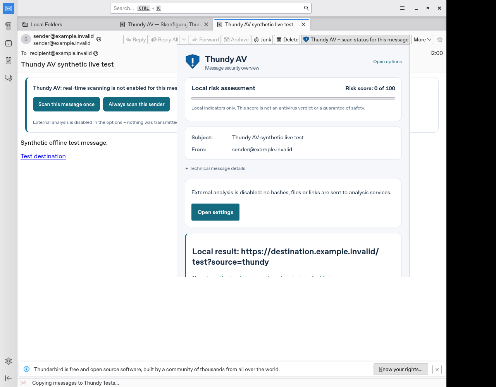
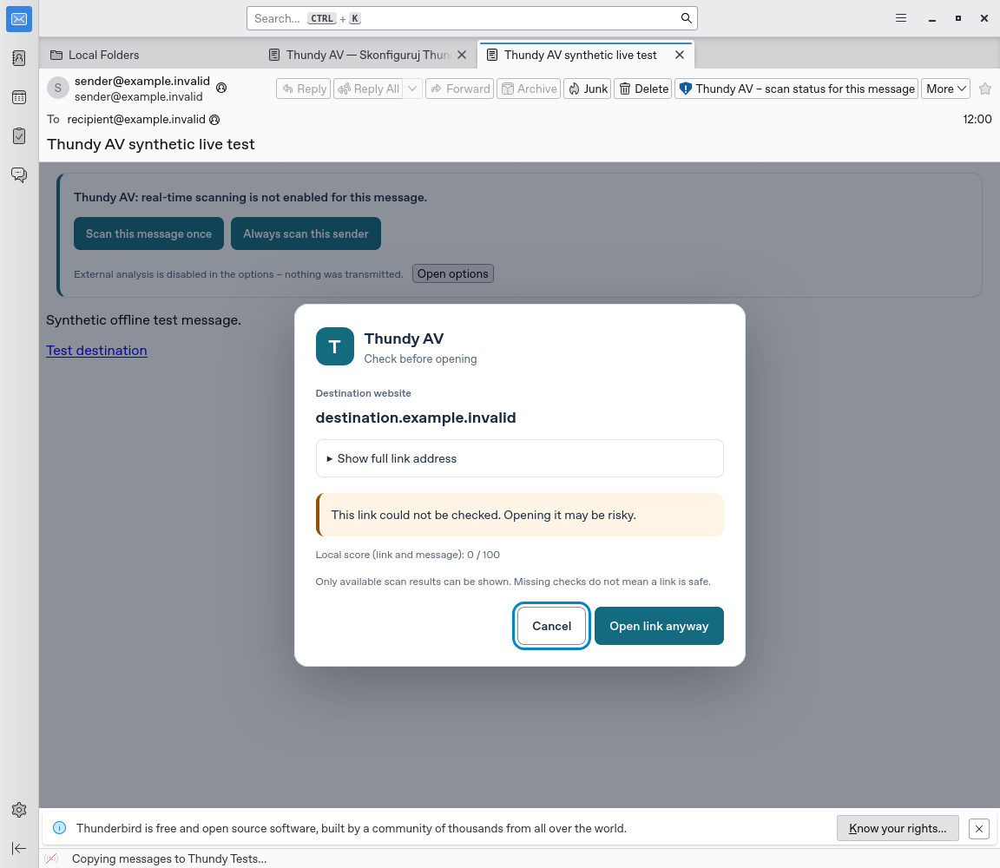
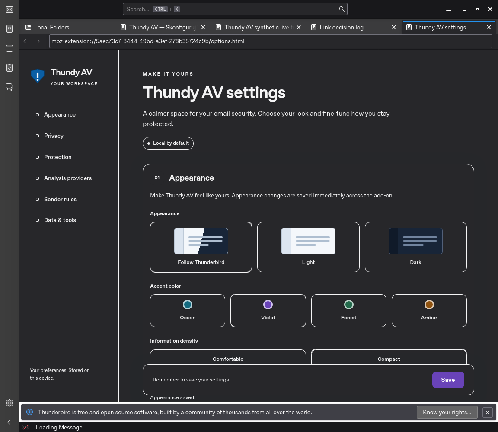
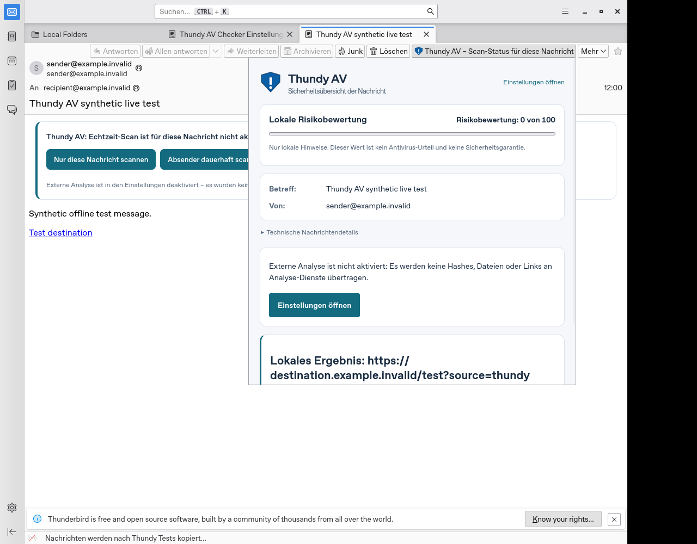
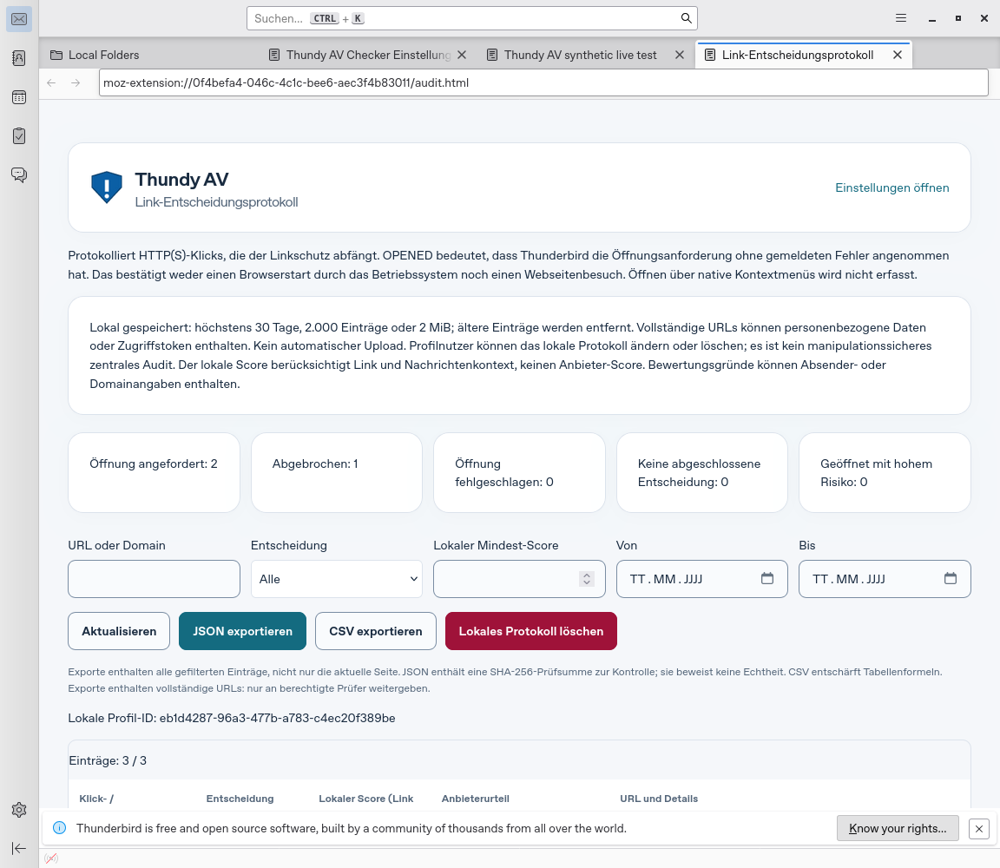
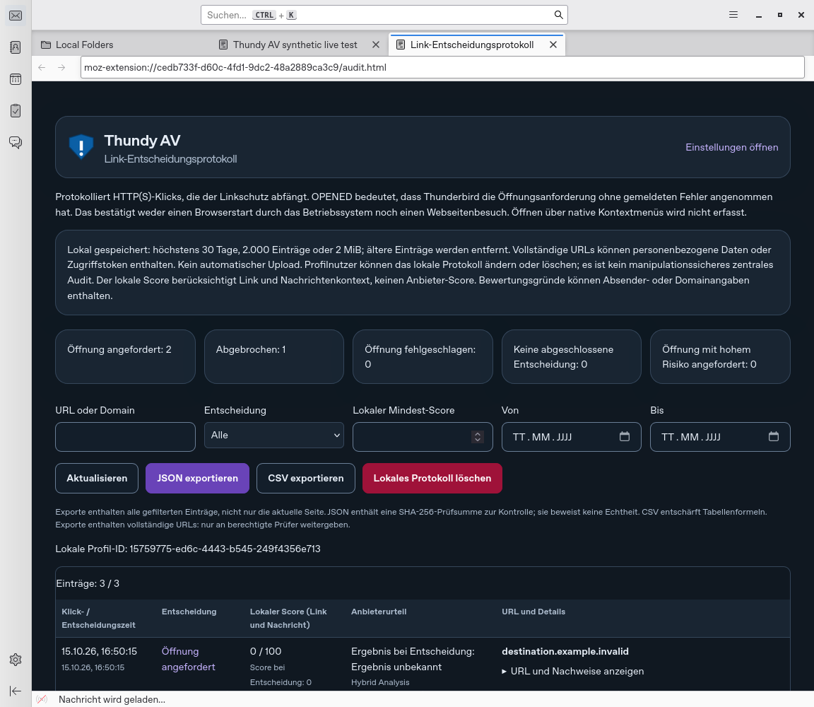
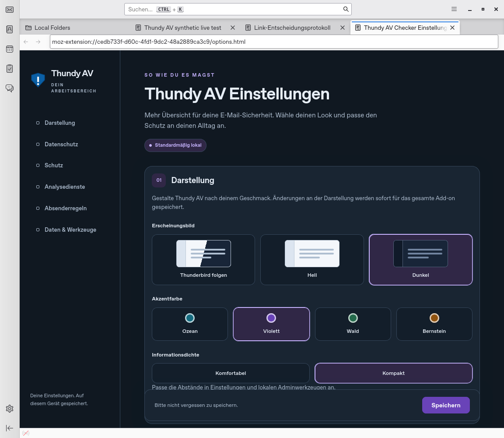
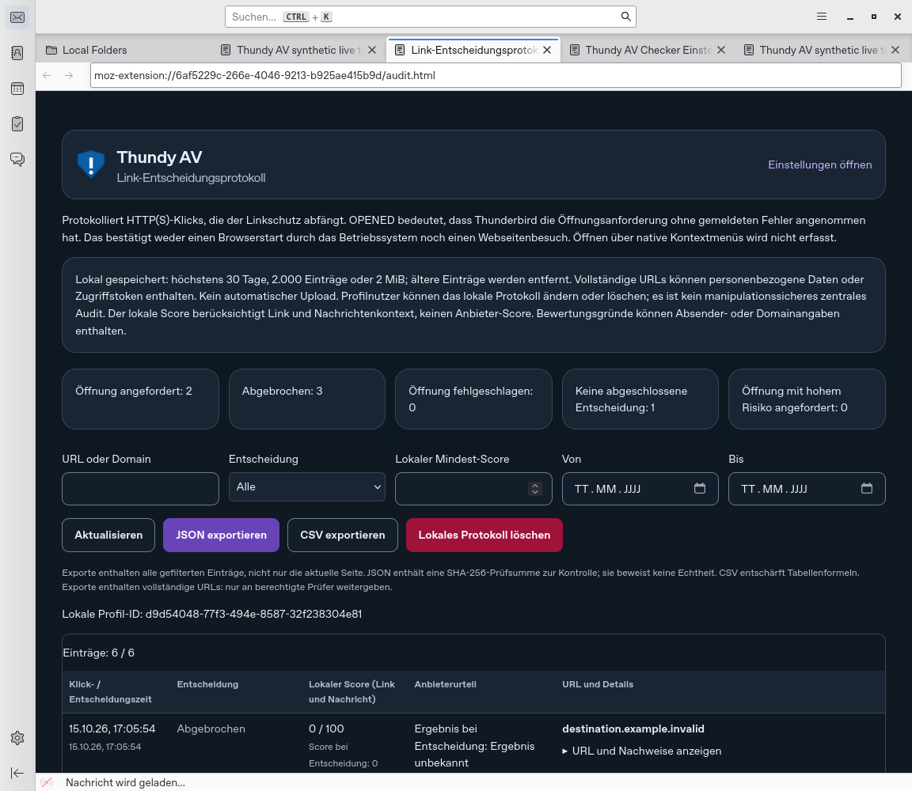

# Reale Thunderbird-Linux-Teilabnahme

Am 15. Oktober 2026 wurde der Quellstand 1.23.0 erstmals in dieser Umgebung in einer echten Thunderbird-GUI geprüft. Der wiederholbare Lauf verwendet Thunderbirds tatsächliche WebExtension-, Nachrichten-, Speicher- und Theme-Schnittstellen. Es werden keine Add-on-APIs nachgebildet. Die zusätzliche Chromium-/axe-Prüfung bleibt ein eigener Prüfumfang.

## Beobachteter Stand

| Merkmal | Tatsächlicher Wert |
| --- | --- |
| Client | Thunderbird 140.17.0 ESR, Build `20260929234105`, Linux x86_64 |
| Herkunft | Debian-Paket `1:140.17.0esr-1~deb13u1`, über signierte Debian-APT-Metadaten bezogen |
| Darstellung | Echte X11-GUI unter Xvfb, 1.280 × 1.000 Pixel; `moz:headless: false` |
| Erweiterung | Lokales, unsigniertes XPI 1.23.0; temporär im neuen Testprofil installiert |
| Daten | Eine synthetische HTML-Nachricht in lokalen Ordnern; ausschließlich `.invalid`-Adressen |
| Verbindung | Thunderbird startet offline; keine echten Konten, Schlüssel oder externe Analyseeinwilligung |
| Lauf | 15. Oktober 2026, 16:17:20–16:17:24 UTC; erfolgreich |

[Maschinenlesbarer Bericht](audits/thunderbird-linux-140.json) mit XPI-/Binary-SHA-256, Client-Build, Messwerten und synthetischem Protokolleintrag. Nur temporärer Profilpfad und Prozess-ID wurden aus der veröffentlichten Berichtskopie entfernt. Das lokal geprüfte XPI hat SHA-256 `17349736c60f1f473123ffacd2937e3f4e222f7c15f8f6d721fe2cb2220a29b8`; erneutes Packen kann einen anderen ZIP-Hash ergeben. Die Runtime entspricht dem Quellstand `16c433b6895cc55051a84df1c1622b6839209455`; diese Fortsetzung ergänzt Testwerkzeug, CI und Nachweise.

## Erfolgreich geprüft

| Prüfung | Nachweis |
| --- | --- |
| Erstinstallation | Der echte Installationsvorgang öffnet den Einrichtungsassistenten. |
| Sechs Wizardsprachen | EN, DE, FR, ES, IT und PL tatsächlich gewählt; Titel gegen den jeweils im XPI enthaltenen Sprachkatalog geprüft. |
| Wizardnavigation und Speichern | Beide Schrittwechsel fokussieren die Überschrift; Abschlussmarker und Linkschutz gespeichert; keine externe Einwilligung erteilt. |
| Nachricht | Echte lokale Nachricht importiert und angezeigt; Add-on-Banner und Linkschutz injiziert. |
| Linkdialog | Anklicken des synthetischen HTTPS-Links öffnet den gebrandeten Dialog mit vollständiger URL und lokalem Score; gemessene Kartenbreite 520 px. |
| Abbrechen | Dialog schließt, Link erhält Fokus zurück; kein Öffnungsversuch. |
| Protokoll | Tatsächliche Hintergrund-API liefert genau einen Eintrag: `ABORTED`, gleiche URL, `scoreAtDecision: 0`, `verdictAtDecision: UNKNOWN`, `openAttempts: 0`. Die lokale Auditseite zeigt ihn an. |
| Natives Nachrichten-Popup | X11-Mausklick auf den echten Toolbarbutton; Popupinhalt 600 px, nativer Rahmen 602 px. Nachricht und Absender sichtbar. |
| Darstellung speichern | Dunkel, Violett und Kompakt über echte Einstellungen gewählt, gespeichert und nach Neuladen wiederhergestellt. |
| Thunderbird-Themes | Bei „Thunderbird folgen“ echte integrierte dunkle und helle Thunderbird-Themes aktiviert; Add-on folgt beiden Änderungen. |

Der Providername im Protokoll bezeichnet die konfigurierte Zuordnung. `UNKNOWN` bei deaktivierter externer Analyse behauptet keine erfolgte Providerprüfung. Der lokale Score 0 garantiert keine Sicherheit.







Die Bilder stammen unverändert aus dem realen Testlauf. Weitere Ansichten, Logs und Bericht werden bei jedem Lauf lokal erzeugt und in der CI als zeitlich begrenztes Artefakt aufbewahrt.

### Optionaler Banner-Nachweis im Runner

`tools/thunderbird-live.dev.py` kennt das zusätzliche, standardmäßig ausgeschaltete Flag
`--banner-root-shot`: Es wartet bis zu 60 Sekunden auf das Opt-in-Banner (`thundy-optin-banner`),
verifiziert programmatisch den Branding-Text und die Buttons (2 Scan-Buttons, optional „Open options",
wenn die externe Analyse deaktiviert ist), schreibt den Zustand als `bannerProbe` in den Bericht und
fängt eine X11-Root-Aufnahme (`optin-banner.png`). Ohne das Flag verhält sich der Runner exakt wie
zuvor; die CI-Abläufe ändern sich nicht.

## Wiederholen

Benötigt werden Linux/X11, Python 3, Thunderbird 140+, Xvfb, `libX11`, `libXtst` sowie ImageMagicks `import` für das native Popupbild. Ein vollständiges Betriebssystempaket ist vorzuziehen. Der hier verwendete Lauf extrahiert authentifizierte Debian-Pakete nur in ein ignoriertes Arbeitsverzeichnis; die Systeminstallation wird nicht verändert.

```sh
npm ci
npm run package
cp build/thundy_av_email_scanner_for_thunderbird-1.23.0.zip build/thundy-av-1.23.0.xpi
python3 tools/thunderbird-live.dev.py \
  --thunderbird /usr/lib/thunderbird/thunderbird-bin \
  --xvfb /usr/bin/Xvfb \
  --xpi build/thundy-av-1.23.0.xpi \
  --out .audit/thunderbird-live
```

Der Ausgabeordner muss neu sein. Der Runner erstellt ausschließlich ein frisches temporäres Profil, startet seinen eigenen Xvfb ohne TCP-Listener und beendet seine Prozesse auch bei Prüffehlern. Vorhandene Benutzerprofile werden nicht geöffnet. Marionette mit Systemzugriff wird nur für dieses wegwerfbare Testprofil aktiviert; der Runner gehört nicht zum XPI. Thunderbird läuft offline; dies ist keine zusätzliche Betriebssystem-Netzwerkisolation.

Die CI führt denselben Runner nach erfolgreichem Paketgate als **Thunderbird Linux GUI** mit dem echten Thunderbird aus Debian Trixie aus. Paket und Bericht enthalten die jeweils tatsächlich geprüfte Version bzw. Hashes; die Paketquelle kann zukünftig einen neueren ESR liefern. `thunderbird-linux-live` enthält JSON, Screenshots und Logs. Der Lauf schlägt bei fehlenden Voraussetzungen oder nicht erfüllten Assertions fehl und ersetzt keinen negativen Befund durch einen simulierten Erfolg.

## Offene Abnahme

Dies ist eine begrenzte Linux-Teilabnahme von 1.23.0, keine vollständige Freigabe und kein neuer Release. Weiterhin offen sind:

- Windows und macOS, unterschiedliche DPI/Zoomwerte, Betriebssystem-Barrierefreiheit und echte Screenreader.
- Alle übrigen Oberflächen in allen sechs tatsächlich eingestellten Thunderbird-Sprachen; der Sprachwechsel dieses Laufs betrifft den Wizard, die übrigen Ansichten liefen englisch.
- Reale externe Browserübergabe einschließlich Fehler/Retry und `OPENED`, Updateinstallation und produktive Nachrichtenkonten.
- Verschlüsselte/signierte Nachrichten und GPU-Pfade. Die lokal extrahierte Laufzeit meldete fehlendes RNP/OpenPGP und `libpci`; diese Teilprüfung verwendet ausschließlich unverschlüsselten Text und beansprucht dafür keine Abdeckung.
- Produktive SSO-/RBAC-, Cloud-/SEALED-, MDM- und unabhängige Prüfernachweise nach [N06](ENTERPRISE_N06_ABNAHME.md).

[Designplan UX05/UX06](DESIGNSYSTEM.md) · [Browserprüfung](UI_BROWSERPRUEFUNG.md) · [Nächste Aufgaben](ENTERPRISE_NAECHSTE_SCHRITTE.md)

## Fortsetzung: Sprachen, Upgrade und OS-Übergabe

Am 15. Oktober 2026, 16:32–16:33 UTC, wurden sechs weitere Läufe mit Thunderbird 140.17.0 ESR erfolgreich abgeschlossen. [Berichte aller sechs Profile](audits/thunderbird-six-languages.json) enthalten die genauen Zeitpunkte, Hashes und Sprachangaben. Der obige erste Lauf bleibt als historischer Nachweis erhalten.

- **Echte UI-Sprachen:** EN, DE, FR, ES, IT, PL über die entsprechenden Thunderbird-Sprachpakete und `Services.locale`. Die tatsächliche WebExtension-UI-Sprache wird geprüft. Popup und Linkdialog sowie die Überschriften von Einstellungen, Audit, Unternehmensprofilen und Datenschutz stimmen mit dem im XPI enthaltenen jeweiligen Sprachkatalog überein. Bei den Upgradeläufen durchläuft zunächst der Wizard der Vorversion 1.22.0 seine sechs Auswahlsprachen; der Bericht kennzeichnet seine Version separat. Ein zusätzlicher direkter Erstinstallationslauf prüft den aktuellen Wizard ohne Vorversion. Das ist eine funktionale Sprachprüfung, keine vollständige visuelle oder sprachwissenschaftliche Abnahme aller Texte.
- **Paketupgrade:** Das veröffentlichte XPI 1.22.0 wird installiert, der Wizard abgeschlossen und danach das lokale XPI 1.23.0 über den echten Add-on-Manager installiert. Abschlussmarker, Linkschutz und fehlende externe Einwilligung bleiben erhalten; kein zusätzlicher Wizard wird geöffnet. Dies ist ein temporäres Add-on-Upgrade ohne Clientneustart; eine dauerhafte Store-/Profilmigration mit Neustart bleibt offen. Vorversion-SHA-256: `4d8003aed95719524524ae18a97be227991d551c2c23ae51e70f5dd85f3663cd`.
- **Tatsächliche OS-Zustellung:** Ein ausschließlich für den Test registrierter XDG-Desktopempfänger erhält exakt die synthetische HTTPS-URL. Die echte Thunderbird-API wird verwendet; kein API-Mock ersetzt sie. Der Empfänger schreibt eine Quittung und ruft keine Webseite ab. Persönliche Standardbrowser-Einstellungen werden nicht geändert.
- **Stiller Fehler:** Mit `network.protocol-handler.external.https=false` nimmt Thunderbird 140 die API-Anforderung weiterhin ohne Fehler an und schließt den Dialog. Innerhalb des einsekündigen Beobachtungsfensters erreicht keine weitere URL den Empfänger. Der zugehörige Eintrag lautet ebenfalls `OPENED`. Dieser bekannte Grenzfall ist nun Bestandteil des Prüflaufs.

Daraus folgt eine Korrektur der Informationsdarstellung: `OPENED` heißt in der Oberfläche **„Öffnung angefordert“**, in allen sechs Sprachen auch in den Enterprise-Ereignis- und Fallansichten. Der Status belegt Thunderbirds Annahme ohne gemeldeten Fehler; er bestätigt weder den Browserstart durch das Betriebssystem noch einen Webseitenbesuch. Schemawerte, ursprüngliche Datensätze und Signaturen bleiben unverändert. `OPEN_ERROR` erfasst ausdrücklich zurückgemeldete Fehler; stille OS-Fehler können damit nicht zuverlässig erkannt werden.





Für einen eigenen Sprach-/Upgrade-Lauf den bestehenden Befehl ergänzen:

```sh
# Beispiel Deutsch; Vorversion muss separat und überprüft bereitgestellt werden.
python3 tools/thunderbird-live.dev.py \
  --thunderbird /usr/lib/thunderbird/thunderbird-bin \
  --xvfb /usr/bin/Xvfb --xpi build/thundy-av-1.23.0.xpi \
  --locale de \
  --langpack /usr/lib/thunderbird/extensions/langpack-de@thunderbird.mozilla.org.xpi \
  --previous-xpi /path/to/thundy-av-1.22.0.xpi \
  --out .audit/thunderbird-live-de
```

Für Spanisch lautet die Sprachpaketkennung `es-ES`, die Runner-Auswahl `--locale es`. Nichtenglische Läufe erfordern ein passendes Sprachpaket; fehlende Pakete werden nicht durch manipulierte Browserantworten ersetzt. Ohne `--previous-xpi` wird eine direkte Erstinstallation geprüft. Die CI installiert alle fünf zusätzlichen Sprachpakete, prüft den fest hinterlegten Hash der veröffentlichten Vorversion und erzeugt sechs unabhängige Upgrade-Profilberichte sowie einen zusätzlichen Erstinstallationsbericht im Artefakt `thunderbird-linux-live`.

Weiterhin offen sind vollständiger Browserstart/-abruf mit unterschiedlichen Standardbrowsern, native Fehler-/Retry-Rückmeldungen auf allen Zielsystemen, dauerhafte Updateinstallation mit Neustart, DPI/Zoom, Screenreader, Windows/macOS sowie die produktiven N06-Kernfunktionen. Diese Erweiterung erteilt keine produktive Freigabe.

## Dauerhafte Installation und saubere Neustarts

Am 15. Oktober 2026 wurden zusätzlich sechs **dauerhafte Profil-Upgrades** mit Thunderbird 140.17.0 ESR erfolgreich geprüft. [Berichte mit Originaleinträgen und Versions-/Sprachnachweisen](audits/thunderbird-permanent-upgrades.json) dokumentieren EN, DE, FR, ES, IT und PL. Jeder Lauf verwendet ein neues isoliertes Profil und zwei saubere Thunderbird-Neustarts, insgesamt zwölf. Profilpfade und Prozess-IDs sind aus der veröffentlichten Berichtskopie entfernt.

| Phase | Tatsächliche Prüfung |
| --- | --- |
| Vorversion installieren | Veröffentlichtes XPI 1.22.0 über den echten Add-on-Manager dauerhaft installiert: aktiv, Profil-Scope, `temporarilyInstalled: false`. Keine Signaturvorgaben werden im Test gelockert. |
| Vorherige Daten erzeugen | Wizard abschließen; echte lokale Nachricht importieren; Abbruch, erfolgreiche OS-Anforderung und stillen OS-Sperrfall ausführen. Drei tatsächliche Auditdatensätze mit URL, Score und ursprünglicher Extensionversion entstehen. |
| Erster Neustart | Über `eAttemptQuit` normal beenden, Exitcode 0 abwarten und im selben Profil mit neuem Prozess starten. Ohne erneute Add-on-Installation sind 1.22.0 und alle vorherigen Storagewerte unverändert vorhanden. Kein zusätzlicher Wizard. |
| Paketupdate | 1.23.0 dauerhaft installieren. Alle vorherigen Storagewerte bleiben erhalten; kein zusätzlicher Wizard. Dunkel/Violett/Kompakt über die tatsächlichen Einstellungen wählen. |
| Zweiter Neustart | Wieder normal beenden und starten. 1.23.0 ist weiterhin aktiv und dauerhaft im Profil installiert. Der vollständige Storage-Snapshot einschließlich Einrichtungsstand, Linkschutz, Profilkennung, drei unveränderten Auditdatensätzen und Darstellungseinstellungen stimmt mit dem Stand vor dem Neustart überein. |
| Erneut benutzen | Persistierte lokale Nachricht öffnen. Der neue Linkschutz injiziert sich, zeigt den richtigen Dialogtitel in der gewählten Sprache und erzeugt nach Abbruch einen vierten Datensatz mit Version 1.23.0. Alle drei ursprünglichen Datensätze bleiben unverändert enthalten. |

Die tatsächlich von der WebExtension gemeldete Sprache bleibt nach beiden Neustarts erhalten. Die Risiko-Zusammenfassung ist ebenfalls in allen sechs Sprachen auf „Öffnung mit hohem Risiko angefordert“ präzisiert; der aktuelle Prüflauf vergleicht sie nach dem Neustart mit dem Sprachkatalog. Die neue Interaktion ist eine echte Bedienhandlung und wird nicht als vorgefertigter Datensatz in den Speicher geschrieben. Die Vorversionsdaten behalten ihre ursprüngliche Version und werden beim Upgrade nicht umgeschrieben. Eine externe Analyseeinwilligung wird weder durch Installation noch Update oder Neustart erteilt.





Den obigen Sprach-/Upgrade-Befehl mit `--restart-check` ergänzen:

```sh
python3 tools/thunderbird-live.dev.py \
  --thunderbird /usr/lib/thunderbird/thunderbird-bin \
  --xvfb /usr/bin/Xvfb --xpi build/thundy-av-1.23.0.xpi \
  --previous-xpi /path/to/thundy-av-1.22.0.xpi \
  --restart-check --locale de \
  --langpack /usr/lib/thunderbird/extensions/langpack-de@thunderbird.mozilla.org.xpi \
  --out .audit/thunderbird-permanent-de
```

Der Modus benötigt zwingend eine ältere Vorversion. Er installiert beide Pakete sowie gegebenenfalls das Sprachpaket dauerhaft **ausschließlich im eigenen temporären Testprofil**. Nach dem Lauf werden nur die selbst gestarteten Prozesse beendet und das Testprofil entfernt; Berichte und Bilder bleiben im neuen Ausgabeordner. Ein fehlgeschlagener sauberer Neustart wird nicht durch einen erzwungenen Prozessabbruch als Erfolg ersetzt. Das Aufräumen darf fehlgeschlagene Prozesse anschließend beenden.

Die CI führt neben der direkten Erstinstallation und sechs temporären Upgrades nun sechs dauerhafte Upgrades mit jeweils zwei sauberen Neustarts aus: **13 Profilberichte und zwölf Neustarts** im Artefakt `thunderbird-linux-live`. Nur lesende Bereitschaftsabfragen dürfen einen dokumentierten Marionette-Navigationsabbruch erneut versuchen; Klicks und Schreibaktionen werden nicht automatisch wiederholt.

Dies schließt die bisher offene Linux-Teilprüfung für dauerhafte Paketupdates und saubere Neustarts. Nicht abgedeckt sind Store-Signierung und Berechtigungsdialoge der manuellen Installation, automatische Updateverteilung, erzwungener Absturz/Wiederherstellung, Rollback sowie andere Thunderbirdversionen und Betriebssysteme. Windows/macOS, Screenreader, DPI/Zoom, unterschiedliche Standardbrowser und produktive N06-Nachweise bleiben offen. Die unsignierten Pakete erhalten durch diesen Prüflauf keine Signierung oder Produktivfreigabe.

## Wiederherstellung nach erzwungenem Prozessabbruch

Der Prüflauf umfasst jetzt zusätzlich zwei tatsächliche `SIGKILL`-Abbrüche je Sprachprofil. Thunderbird und seine gemeinsam gestartete Prozessgruppe werden ohne reguläre Beendigung beendet und im selben Testprofil neu gestartet. Es werden weder ein Storage-Flush noch ein künstliches Abwarten vor dem Abbruch eingefügt. Persönliche Profile und andere Prozesse werden nicht angesprochen; der Runner prüft vor dem Signal die Zuordnung seiner eigenen Prozessgruppe.

Die [Wiederherstellungsberichte](audits/thunderbird-crash-recovery.json) dokumentieren folgende Fälle:

| Fall | Erwartung und Prüfung |
| --- | --- |
| Bestätigte Daten | Vier bereits über die echte Storage-Schnittstelle gelesene Auditdatensätze und sämtliche vorherigen lokalen Storagewerte bleiben nach dem ersten erzwungenen Abbruch unverändert erhalten. |
| Offener Dialog | Während der Linkdialog auf eine Entscheidung wartet, wird erneut abgebrochen. Der gespeicherte fünfte Vorgang bleibt nach dem Neustart `PENDING`, mit unveränderter URL und Bewertung, ohne Entscheidungszeit oder Öffnungsversuch. |
| Keine erfundene Entscheidung | Der Prüflauf akzeptiert weder eine nachträglich erzeugte Öffnung noch einen automatischen Abbruch für diesen offenen Vorgang. Ein Prozessverlust beweist keine Nutzerentscheidung. |
| Keine erneute OS-Zustellung | Der isolierte Desktopempfänger erhält beim Wiederanlauf keine weitere URL. Die vorhandene Quittung bleibt unverändert. |
| Weiterarbeiten | Sprache und Dunkel/Violett/Kompakt bleiben erhalten. Der echte Linkschutz erzeugt nach dem zweiten Wiederanlauf einen sechsten Vorgang mit Version 1.23.0; die fünf vorherigen Datensätze bleiben unverändert. |

Die lokale Auditansicht hatte dabei einen tatsächlichen Darstellungsfehler: Ein bereits geöffneter Tab zeigte bei der Rückkehr weiterhin seinen alten Datenstand. Sie lädt nun beim Sichtbarwerden erneut. Filter, Seitenauswahl innerhalb der vorhandenen Ergebnisse, aufgeklappte Nachweise und der Tastaturfokus bleiben soweit die betreffenden Zeilen noch sichtbar sind erhalten. Späte Antworten oder Fehler älterer Leseanforderungen überschreiben keinen neueren Stand. Es gibt kein Hintergrund-Polling. Der Refresh-Button bleibt verfügbar. Zwei gezielte Regressionstests sichern diese Verhaltensweisen ab; der echte Thunderbird-Lauf prüft die aktualisierte Ansicht nach der neuen Entscheidung.



Den dauerhaften Upgradetest mit `--crash-check` ergänzen:

```sh
python3 tools/thunderbird-live.dev.py \
  --thunderbird /usr/lib/thunderbird/thunderbird-bin \
  --xvfb /usr/bin/Xvfb --xpi build/thundy-av-1.23.0.xpi \
  --previous-xpi /path/to/thundy-av-1.22.0.xpi \
  --restart-check --crash-check --locale de \
  --langpack /usr/lib/thunderbird/extensions/langpack-de@thunderbird.mozilla.org.xpi \
  --out .audit/thunderbird-recovery-de
```

`--crash-check` erfordert `--restart-check` und damit eine passende Vorversion. Die CI erweitert die bestehenden sechs dauerhaften Upgradeprofile um diese Fälle: insgesamt weiterhin 13 Profilberichte, dazu zwölf saubere Neustarts und zwölf Wiederanläufe nach `SIGKILL`. Die Zusammenfassung nennt die tatsächlich ausgeführten Neustartarten. Bei einem Fehler wird der Bericht ausdrücklich als fehlgeschlagen markiert, auch wenn die vorherigen Prüfschritte bestanden waren.

Diese Prüfung betrifft Prozessverluste unter Linux nach bestätigten Storage-Lese-/Schreibantworten beziehungsweise bei einem gespeicherten offenen Vorgang. Sie simuliert keinen Stromausfall, keinen Datenträgerdefekt und keinen Abbruch während einer noch unbestätigten Speicheroperation. Automatische Updateverteilung, Rollback, Windows/macOS, Screenreader, weitere Standardbrowser und produktive N06-Nachweise bleiben offen.
