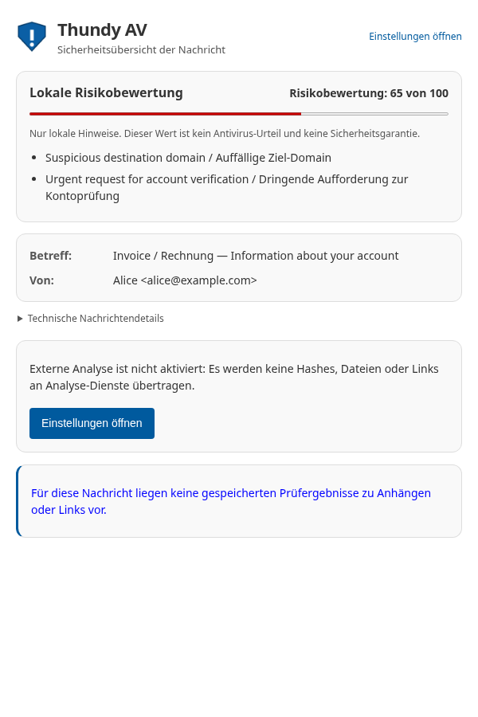
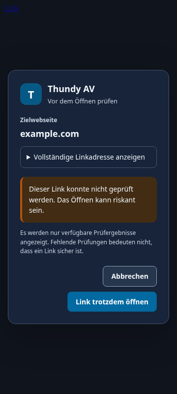

# Regression checklist — Thundy AV 1.19.1

This patch corrects the popup sizing and link-opening regressions in 1.19.0. Automated checks and Chromium rendering previews supplement the [1.19.0 live protocol](live_test_1_19_0.md); a real Thunderbird client is still needed for the final acceptance below.

## Real Thunderbird checks (pending)

Use Thunderbird 140 ESR and a current supported version, with the unsigned 1.19.1 XPI installed and an HTTP(S) link in a displayed message.

- Open the Thundy AV message-action popup repeatedly: it must retain a readable width, with no strip or one-letter columns. Test light/dark appearance and enlarged text.
- Confirm normal, Ctrl/Command, Shift and middle-click links. The default system browser must open the exact URL once, including path/query/fragment. The message must remain displayed.
- Right-click a link: the native context menu must remain available, including the Thundy AV scan entry.
- Cancel or press Escape during and after checking: no URL must open; focus returns to the original link.
- Switch the displayed message while the dialog is open; confirming the old link must fail rather than open in a changed context.
- Check clean, suspicious and unavailable-provider cases. Unknown must remain unknown, with no claim of safety. Malicious/suspicious results must show a warning and explicit override action.
- Simulate an unavailable default browser: the dialog must show an opening error and allow retry/cancel.
- Without external consent/API credentials, local risk and the consent notice must remain visible after the result list renders. No external provider request may run.
- Repeat in EN, DE, FR, ES, IT and PL. Expand full addresses with long paths and technical message details. Confirm tab order, keyboard activation, narrow panes and screen-reader labels.

## Verified in the development environment

- 493 automated tests, including actual default-browser handoff, failure/retry, pending cancellation, right-click behavior, unsafe schemes and message/destination changes.
- 30 Chromium layout cases: six languages × two popup color schemes, plus six languages × three dialog layouts (360 px dark, 1000 px light and 200% zoom).
- Popups start with a simulated 128 px viewport and retain their 600 px intrinsic width; final rendered popup content fits the 600 px window.
- Dialogs retain visible buttons and avoid horizontal content overflow even when email CSS hides buttons and forces ordinary divs to 1 px width.
- Previews below use mocked message data in Chromium. They do not demonstrate a Thunderbird installation or a real provider verdict.

