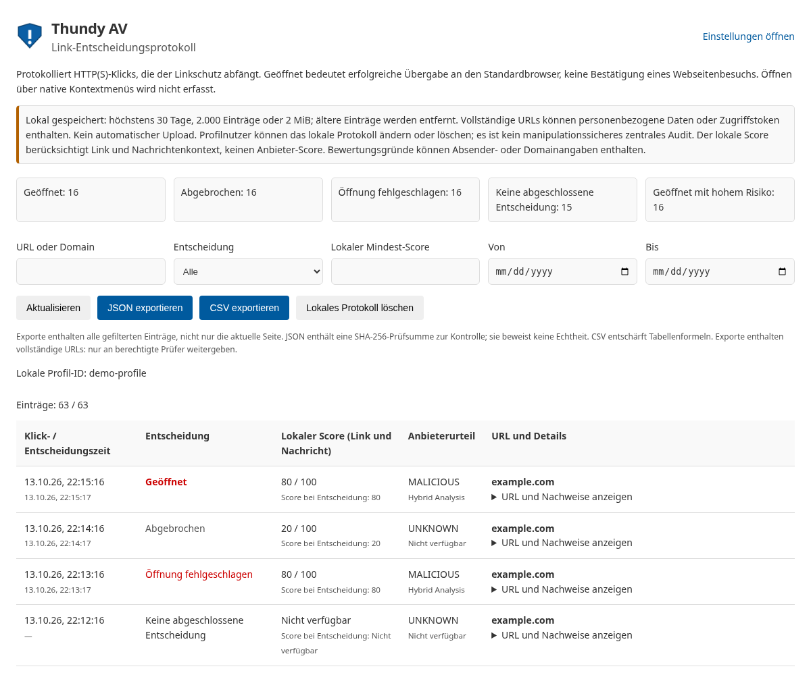
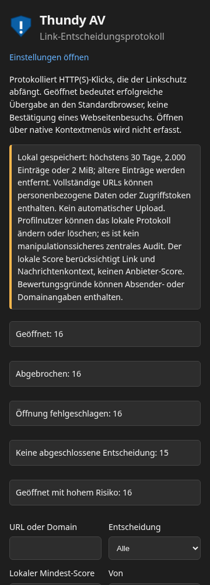

# Linkprotokoll — Live-Abnahme 1.20.0

Die bisherigen [Popup-/Linktests](live_test_1_19_1.md) bleiben gültig. Zusätzlich in Thunderbird 140 ESR und einer aktuellen Version prüfen:

1. Ohne API-Schlüssel und ohne externe Zustimmung einen HTTP(S)-Link anklicken. „Linkprotokoll prüfen“ zeigt die URL, Zeitstempel, lokalen Kontext-Score und das unbekannte Anbieterurteil; keine externe Anfrage darf stattfinden.
2. Im Dialog „Im Browser öffnen“ bzw. „Link trotzdem öffnen“ wählen: genau eine Browserübergabe, anschließend `OPENED`. Der tatsächliche Webseitenbesuch wird nicht behauptet.
3. „Abbrechen“ und Escape vor/nach dem Prüfergebnis testen: `ABORTED`, passender Grund und keine Browserübergabe. Während einer Öffnung kann keine gegensätzliche Abbruchentscheidung ausgelöst werden.
4. Prüfung verzögern und vorher abbrechen. Späteres Ergebnis ergänzt die Evidenz; Entscheidung und damaliger Score-/Urteilsstand bleiben erhalten.
5. Öffnungsfehler simulieren: `OPEN_ERROR`; Wiederholung verwendet dieselbe Ereignis-ID und erhöht die Versuchsanzahl.
6. Zieladresse ändern oder Nachrichtenansicht schließen. Abbruchgrund prüfen; bei Client-Absturz darf ein offener Eintrag bestehen bleiben.
7. Score ≥ 50 und/oder verdächtiges Anbieterurteil bestätigen: Admin-Übersicht markiert „Geöffnet mit hohem Risiko“. Spätere Warnungen erzeugen keine rückwirkende Behauptung, die Warnung sei beim Öffnen bekannt gewesen.
8. Alle Filter kombiniert testen. Bei mehr als 50 Einträgen weitere Seiten öffnen; JSON-/CSV-Export muss sämtliche gefilterten Einträge enthalten. JSON mit `node scripts/verify-link-audit-export.js <datei.json>` prüfen. Geänderte Payload muss abgelehnt werden.
9. Lange URLs, Query-Token und Formelzeichen in Evidenz exportieren. CSV-Zellen dürfen keine Tabellenformeln aktivieren; URLs in der Übersicht sind Text und öffnen keine Webseite.
10. „Cache leeren“ behält Linkprotokolle. Protokoll-Löschung muss einen eigenen Bestätigungsdialog haben und Einstellungen/Scanresultate behalten.
11. Speicherfehler simulieren: sichtbare Fehlermeldung; keine falsche Aussage über garantierte Protokollierung.
12. EN/DE/FR/ES/IT/PL, helle/dunkle Darstellung, Tastaturbedienung, 200 % Zoom und schmale Ansichten prüfen.

Automatisiert geprüft: 517 Tests, 0 Lint-Fehler/24 dokumentierte Thunderbird-Warnungen, Paketvalidierung und 48 Chromium-Layoutfälle. Die reale Thunderbird-Abnahme steht aus.

Die folgenden Vorschauen stammen aus Chromium mit simulierten Ereignissen, nicht aus einem echten Unternehmensprofil oder Thunderbird-Client:

